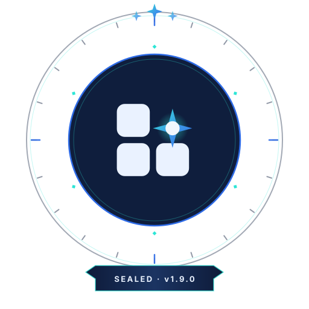

<div align="center">



# PySide-Nova

> **PySide-Nova is the Quasar of the QML world.**
> **PySide-Nova，QML 世界的 Quasar。**

**An enterprise-grade, cross-platform Qt Quick component library for PySide6.**
*Inspired by Quasar · Built on Qt Quick for PySide6.*

**One component set. Desktop, mobile and industrial large-screen.** Built on Qt's native
rendering engine, Nova turns professional UI craft into standardized components and
*Prescient Layout Shells* — safe margins, theme wiring, responsive rules and boundary
fallbacks are built in, so developers who are not UI specialists still ship polished,
stable, industrial-grade interfaces.

[](https://github.com/eagleye-china/pyside-nova/actions/workflows/ci.yml)
[](https://pypi.org/project/pyside-nova/)
[](https://pypi.org/project/pyside-nova/)
[](https://www.qt.io/)
[](https://github.com/eagleye-china/pyside-nova/blob/main/LICENSE)
[](https://github.com/eagleye-china/pyside-nova/blob/main/CHANGELOG.md)
[](https://github.com/eagleye-china/pyside-nova)

</div>

> 🇨🇳 中文文档：**[README_zh.md](https://github.com/eagleye-china/pyside-nova/blob/main/README_zh.md)**

## Status at a glance

| Item | Value |
|---|---|
| **Version** | **1.9.0** — additive minor over 1.8.0: `NovaTable` Quasar QTable alignment (full scoped-slot system, column metadata, column picker, true grid card mode, fullscreen / CSV / load-more intents, dense/separator/responsive, no-results state, page-size UI) with a 1.9.0 API re-sign; **1.8.0** (`NovaDataGrid` P1/P2 polish) / **1.7.0** (P0 polish) are released baselines, **1.6.0** added public type **`NovaAIReport`**; 1.5.0 / 1.4.0 and earlier are historical states |
| **Parity baseline** | Quasar **2.35.5** (verified against official releases) |
| **Public QML types** | **147** — Controls 93 · Behaviors 13 · Services 16 · Design 4 · Composite.LayoutShell **21** |
| **API freeze** | 147 types, zero drift · fingerprint `b15a4be38c000c59` (1.9.0 additive re-sign: NovaTable Quasar alignment; 1.8.0 `89d5d3cdd7f94cf0` / 1.7.0 `157ab2b1d77ea9f9` retained as history) |
| **Runtime** | Python ≥ 3.10 · PySide6 ≥ 6.8 (verified on **6.12.0**) · Windows / macOS / Linux |
| **Quality gates** | static 3/3 PASS · 97 targeted tests passed · 21/21 ceiling audit · 15/15 foundations audit · qmllint 0 error |

- **Flagship Standard**: Robustness · Solidity · Aesthetics · Prescience
- **Methodology**: **CARF** — Conceive, Achieve, Refine, Freeze — Culminate to the peak
  ([母法卷首宣言](https://github.com/eagleye-china/pyside-nova/blob/main/docs/CONSTITUTION.md)) · all 20 composite root containers audited to the ceiling
  ([ceiling ledger](https://github.com/eagleye-china/pyside-nova/blob/main/docs/prescript/AUDIT_CEILING.md))
- **Constitution**: [docs/CONSTITUTION.md](https://github.com/eagleye-china/pyside-nova/blob/main/docs/CONSTITUTION.md) (mother law) + [docs/COMPOSITION_CONSTITUTION.md](https://github.com/eagleye-china/pyside-nova/blob/main/docs/COMPOSITION_CONSTITUTION.md) (Layout Shell sub-law)
- **White papers**: [Flagship White Paper](https://github.com/eagleye-china/pyside-nova/blob/main/docs/prescript/WHITEPAPER.md) · [Prescient Layout Shell Frozen Spec](https://github.com/eagleye-china/pyside-nova/blob/main/docs/prescript/SPEC_FREEZE.md)
- **Authoritative index**: [docs/COMPONENT_LIST.md](https://github.com/eagleye-china/pyside-nova/blob/main/docs/COMPONENT_LIST.md) — generated, never hand-edited

## Why pyside-nova

Qt Quick Controls covers the basics, but enterprise apps need the *whole* Quasar story:
opinionated theming, breakpoints, icon sets, form systems, data tables, notifications,
and — above all — a page skeleton that already looks right. Three structural problems
keep recurring in cross-platform GUI work:

- **Fragmented platforms.** Desktop, mobile and large-screen builds drift into separate
  codebases, duplicating the same business logic and diverging on design.
- **The Web-shell ceiling.** Browser-kernel stacks ship heavy, start slow, accumulate
  memory over 7×24 uptime, and are weak on serial / USB / CAN / video hardware — with
  almost no mobile or large-screen story.
- **Stability vs. beauty, pick one.** Native code is solid but slow to build; Web UI is
  flexible but drops frames. Few teams own an asset that delivers both.

**pyside-nova borrows Quasar's component-driven ideas and adapts them to Python desktop
development**, with a Quasar-familiar API so Vue/Quasar developers feel at home — and a
frozen, audit-friendly enterprise release process for everyone else. It is inspired by
Quasar, not a port or fork of it ([relationship & credit](https://github.com/eagleye-china/pyside-nova/blob/main/docs/QUASAR_ACKNOWLEDGEMENT.md)).

> **One-line position:** steadier than Electron, broader than Flutter, faster than
> per-platform native development — one component set, native-grade fluency on every screen.

## Architecture

```
┌──────────────────────────────────────────────────────────┐
│  Business Applications        业务应用层                  │  pages · tools · data
├──────────────────────────────────────────────────────────┤
│  Prescient Layout Shell       组合根容器层（20 项）        │  skeleton · slots · identity
├──────────────────────────────────────────────────────────┤
│  Controls / Behaviors         基础组件层                  │  buttons · lists · dialogs · forms
├──────────────────────────────────────────────────────────┤
│  Services / Design            主题与设计基座              │  NovaTheme · NovaMotion · NovaScreen
└──────────────────────────────────────────────────────────┘
```

**Five QML modules**, all shipped inside the wheel:

| Module | Types | Responsibility |
|---|---:|---|
| `Nova.Controls` | 91 | Single-responsibility controls, layout primitives, form & data widgets |
| `Nova.Behaviors` | 13 | Attached interaction behaviors (ripple, drag, hover, focus ring …) |
| `Nova.Services` | 16 | Singletons: `NovaTheme`, `NovaScreen`, `NovaPlatform`, `NovaI18n` … |
| `Nova.Design` | 4 | Design language: `NovaMotion` (transitions), a11y design variables |
| `Nova.Composite.LayoutShell` | 20 | The 20 business-free composite root containers |

> Direction of dependency is strictly downward. A Layout Shell never imports business
> code, never hard-codes a menu/route/copy, and can always be previewed standalone in
> the Gallery.

## Features

- 🎨 **Three-tier design tokens** — base → semantic → component tokens in the `NovaTheme`
  singleton; light/dark with one call; runtime brand re-skinning.
- 🧩 **Quasar-style API** — `QBtn → NovaBtn`, `QCard → NovaCard`; property names aligned,
  near-zero learning cost for Quasar developers.
- 🧱 **Slot system** — Quasar slots mapped to QML: default slot → `default property alias`,
  named slots → composed sub-components, scoped slots → `Component` delegates.
- 🏗️ **20 Prescient Layout Shells** — page skeletons with fixed slots, safe margins,
  breakpoint collapse, theme wiring and *per-component visual identity*; no two look alike.
- 🖥️ **Breakpoints** — `NovaScreen` ports Quasar's Screen plugin 1:1
  (xs/sm/md/lg/xl = 600/1024/1450/1920, `is*` / `lt*` / `gt*`).
- 🖼️ **Dual-channel icons** — `NovaIcon { icon: "mdi:home" }` resolves MDI / Material
  icons from a local pack (offline) with automatic CDN fallback.
- 🎬 **Unified motion** — every Shell animation reads `NovaMotion.duration()` and
  `NovaMotion.easingStandard`; `reducedMotion` short-circuits all transitions and
  `speedFactor` retimes the whole library at once.
- ♿ **A11y by contract** — 146/146 types registered as interactive / semantic /
  decorative; decorative containers deliberately carry no `Accessible.*` noise.
- 📦 **pip-ready** — QML modules ship inside the wheel; one line to bootstrap.
- ✅ **Verified, not promised** — static gate (a11y → API freeze → qmllint), 478 pytest
  cases, 31/31 headless instantiation, qmllint 0 error on a real QML engine.

## The 20 Prescient Layout Shells

All 20 live in `Nova.Composite.LayoutShell`, are frozen public types, and each owns a
distinct structural identity element (pure decoration, zero business semantics).

| Category | Component | Typical scenario | Identity element |
|---|---|---|---|
| Primary nav (4) | `NovaSidebar` | Tools, back office, AI workbench | Brand gradient rail + floating sidebar card |
| Primary nav (4) | `NovaTopNavigation` | Lightweight config tools | Capsule nav bar + floating dropdown |
| Primary nav (4) | `NovaDualSide` | Editors, configurators, node tools | Center dot-grid canvas + dual floating panels |
| Primary nav (4) | `NovaTabShell` | Multi-document / multi-task | Material tab bar + underline indicator |
| Multi-column (3) | `NovaThreeColumn` | Tree → list → detail, galleries | Three-step depth tones + drag grips |
| Multi-column (3) | `NovaCompare` | Side-by-side diff | Center seam handle + A/B color bands |
| Multi-column (3) | `NovaCardGrid` | Card grids, asset/template markets | Filter toolbar + Flow grid skeleton |
| Overlay (2) | `NovaModal` | Modal config & form dialogs | Top tri-color bar + catcher + elevation |
| Overlay (2) | `NovaDrawerPanel` | Non-modal temporary side panel | Edge gradient rail + grabber |
| Standalone (2) | `NovaSetupWizard` | Install / new-project / init flows | Three-state step timeline |
| Standalone (2) | `NovaBlankPage` | Clean single page, embedded sub-page | Centered reading column |
| Root shell (3) | `NovaDesktop` | Desktop app root | Window control dots + layered bars |
| Root shell (3) | `NovaMobile` | Mobile app root | Dynamic island + home indicator |
| Root shell (3) | `NovaFlexLayout` | Large-screen / HMI | Column-driven floating panel grid |
| AI window (1) | `NovaChat` | AI assistant main window | Six-track, per-track exclusive signatures |
| AI workbench (3) | `NovaAgent` | Agent task-execution workbench | DAG task rail + gradient edge + approval band |
| AI workbench (3) | `NovaDE` | Digital-employee role workbench | Diamond role badge + stacked queue cards + SLA rail |
| AI workbench (3) | `NovaCopilot` | Collaborative copilot panel | Capsule suggestion rail + confirmation levels + undo arc |
| Intent orbit (1) | `NovaOrbit` | Intent-orbit workbench | Tri-rail hairlines + bifurcation marks + topology dot-matrix |
| Incubator (1) | `NovaIncubator` | Application incubator workbench | Four-stage wedge bar + seven-zone ring + certificate seal |

> Slots follow one semantic contract so a business page can migrate between shells.
> The full property/signal/slot tables and dependency lists live in the
> [module README](https://github.com/eagleye-china/pyside-nova/blob/main/src/pyside_nova/qml/Nova/Composite/LayoutShell/README.md).

## Installation

```bash
pip install pyside-nova          # from PyPI
pip install -e ".[dev]"          # local development
```

## Quick start

```python
# main.py
import sys
from PySide6.QtGui import QGuiApplication
from PySide6.QtQml import QQmlApplicationEngine
from pyside_nova import init_nova

app = QGuiApplication(sys.argv)
engine = QQmlApplicationEngine()
init_nova(engine)          # registers all Nova.* QML import paths
engine.load("main.qml")
sys.exit(app.exec())
```

> **High-frequency pitfall:** call `init_nova(engine)` before `engine.load(...)`. It registers all `Nova.*` QML import paths; skipping it makes Qt report `module "Nova.Controls" is not installed`.

```qml
// main.qml
import QtQuick
import QtQuick.Controls.Basic
import Nova.Services
import Nova.Controls
import Nova.Behaviors

ApplicationWindow {
    visible: true
    color: NovaTheme.page

    Column {
        anchors.centerIn: parent
        spacing: 12
        NovaBtn { text: "Primary action" }
        NovaChip { text: "QML"; removable: true }
        Rectangle {
            width: 140; height: 60; radius: 8
            color: NovaTheme.primary
            NovaRipple { }
        }
        NovaBtn {
            icon: "🔔"
            round: true
            NovaBadge { text: "99+" }
        }
    }
}
```

Start from a Layout Shell when you need a whole application frame:

```qml
import QtQuick
import Nova.Composite.LayoutShell
import Nova.Controls

NovaSidebar {
    anchors.fill: parent
    sidebarSize: 260
    sidebarSlot: NovaText { text: "Navigation injected by the app" }
    contentSlot: MyBusinessPage { }   // supplied by your application
    footerSlot: NovaText { text: "Powered by pyside-nova" }
}
```

> **API note**: the accent-color property is named `tint` (not `color`) because `color`
> clashes with the base `Rectangle` property in QML — same visual role as QBtn's `color`.

### Gallery

```bash
python examples/gallery_launch.py             # full gallery (sidebar + 20 Shell pages)
python examples/gallery/layout_shells.py      # gallery launcher
python examples/layout_shell/agent/run.py     # one standalone Shell demo
```

## Project layout (src layout)

```
pyside-nova/
├── pyproject.toml                  # hatchling packaging, QML ships in the wheel
├── src/pyside_nova/
│   ├── __init__.py                 # init_nova(engine)
│   ├── __about__.py                # single source of version truth
│   └── qml/Nova/
│       ├── Controls/               # 91 controls & layout primitives
│       ├── Behaviors/              # 13 attached behaviors
│       ├── Services/               # 16 singletons (NovaTheme / NovaScreen / …)
│       ├── Design/                 # 4 design-language types (NovaMotion / …)
│       └── Composite/LayoutShell/  # 20 composite root containers + qmldir + README
├── examples/
│   ├── demo/                       # compact demo
│   ├── gallery/                    # component gallery (sidebar + pages)
│   └── layout_shell/               # 20 standalone Shell demos
├── docs/                           # constitutions, white papers, generated indexes
├── scripts/                        # generators, gates, icon fetch, local deploy
├── tests/                          # 478 pytest cases
└── .github/workflows/              # CI (Win+Linux) and PyPI trusted release
```

Every `.py` / `.qml` file starts with a two-line header comment — line 1 is the
full subpath starting from `src/`, line 2 is a one-sentence description that
feeds the API docs. Date-stamp headers are forbidden.

## Cross-platform comparison

| Dimension | pyside-nova | Electron | Flutter | Native per-platform |
|---|---|---|---|---|
| Desktop performance | Native rendering, memory-friendly | Heavy kernel, large footprint | Desktop less mature | Best, highest cost |
| Mobile | Android packaging, component reuse | Essentially unsupported | Strong | Separate codebase per OS |
| Large-screen / embedded | Qt's home turf | Long-run frame drops | Weaker | Vendor-dependent |
| Hardware I/O | Serial / USB / CAN / video, complete | Weak | Limited | Complete |
| Language | Python + QML | JS/TS + Web | Dart | Per-platform |
| Ecosystem | Python data & scripting | npm | Dart | Isolated |
| Dev efficiency | High, low learning curve | Fast for web devs | Requires Dart | Lowest |

> Qualitative comparison, not a benchmark. Choose against your team's skills, delivery
> window and target platforms. Qt/PySide6 is most balanced when desktop + mobile +
> large-screen + hardware I/O appear in the same product.

## Use cases

- Enterprise desktop tools, IDEs and plugin workbenches
- AI assistant clients, conversation and content-management surfaces
- Configuration managers, resource browsers, icon and template libraries
- Android companion apps and lightweight mobile tools
- Industrial HMI, control-room large screens, data-visualization consoles
- Professional terminals interfacing serial, USB, CAN or video streams

## Engineering & release gates

```bash
python scripts/check_all.py --tier static     # a11y -> API freeze -> qmllint (seconds)
python scripts/check_all.py --tier dynamic    # perf / visual / soak / HiDPI (minutes)
python scripts/check_all.py --tier all        # full 8-gate freeze acceptance
pytest -q                                    # 478 cases
python -m build                              # sdist + wheel
```

- **API freeze** — public `property` / `signal` / `function` / `alias` signatures are
  snapshotted into `api/nova-api-1.0.0.json`; private `_` members are excluded.
  Destructive API changes require a MAJOR bump and a single batch re-sign.
- **Generated artifacts** — `COMPONENT_LIST.md`, `API_FREEZE.md`, `A11Y_MATRIX.md`,
  `docs/ai/api/*.json` are produced by generators; never hand-edit them.
- **Lint budget** — qmllint errors are zero-tolerance; warnings are capped by
  `tests/lint-baseline.json`.
- **Documentation hierarchy** — white paper sets the tone, the frozen spec sets the
  red lines, `COMPONENT_LIST.md` is the single source of truth on maturity.

### Release to PyPI (Trusted Publishing)

1. GitHub repo → Settings → Environments → create `pypi`
2. PyPI → Publishing → add Trusted Publisher (repo + workflow `release.yml` + env `pypi`)
3. Tag and push:

```bash
git tag v1.0.0
git push origin v1.0.0
```

## Versioning strategy

- Independent SemVer; version numbers are not locked to Quasar releases.
- **Patch** (e.g. `1.2.0 → 1.2.1`) is for private-token and delivery polish with zero public API drift; the API contract stays at `1.2.0`.
- **Additive public types** bump minor and require a single batch freeze re-sign; destructive signature changes require major.
- Published property names are never removed or renamed; semantics may only be appended, and aliases are forbidden.
- Runtime floor: Python ≥ 3.10 · PySide6 ≥ 6.8 (verified on 6.12.0).

## Documentation

- [Flagship White Paper](https://github.com/eagleye-china/pyside-nova/blob/main/docs/prescript/WHITEPAPER.md) — manifesto, architecture,全端方案
- [Prescient Layout Shell Frozen Spec](https://github.com/eagleye-china/pyside-nova/blob/main/docs/prescript/SPEC_FREEZE.md) — acceptance red lines & slot contract
- [Layout Shell module README](https://github.com/eagleye-china/pyside-nova/blob/main/src/pyside_nova/qml/Nova/Composite/LayoutShell/README.md) — all 20 contracts & dependency lists
- [Component index](https://github.com/eagleye-china/pyside-nova/blob/main/docs/COMPONENT_LIST.md) — 146 types, generated
- [Relationship with Quasar & credit](https://github.com/eagleye-china/pyside-nova/blob/main/docs/QUASAR_ACKNOWLEDGEMENT.md) — inspired by, not a fork
- [Architecture Constitution](https://github.com/eagleye-china/pyside-nova/blob/main/docs/CONSTITUTION.md) · [Composition Constitution](https://github.com/eagleye-china/pyside-nova/blob/main/docs/COMPOSITION_CONSTITUTION.md)
- [Ecosystem Parity](https://github.com/eagleye-china/pyside-nova/blob/main/docs/ECOSYSTEM_PARITY.md) · [CHANGELOG](https://github.com/eagleye-china/pyside-nova/blob/main/CHANGELOG.md)

## License

[MIT](https://github.com/eagleye-china/pyside-nova/blob/main/LICENSE)

---

<div align="center">

**One component set. Every screen.**

*Native-grade performance · enterprise-grade discipline · flagship-grade finish*

</div>
