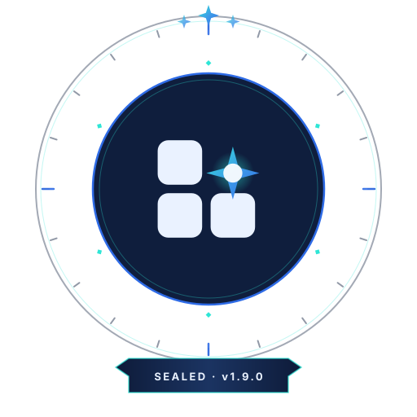

<div align="center">



# pyside-nova

> **PySide-Nova，QML 世界的 Quasar。**
> **PySide-Nova is the Quasar of the QML world.**

**面向 PySide6 的企业级全端 Qt Quick 组件库。**
*受 Quasar 启发 · 基于 Qt Quick，为 PySide6 而生。*

**一套组件，覆盖桌面、移动端与工业大屏。** 依托 Qt 原生渲染引擎，Nova 把专业 UI 设计经验
沉淀为标准化组件与「预判式布局壳」——安全边距、主题联动、自适应规则与边界容错提前内置，
让不精通 UI 的开发者也能开箱产出工整、精致、稳定的企业级界面。

[](https://github.com/eagleye-china/pyside-nova/actions/workflows/ci.yml)
[](https://pypi.org/project/pyside-nova/)
[](https://pypi.org/project/pyside-nova/)
[](https://www.qt.io/)
[](https://github.com/eagleye-china/pyside-nova/blob/main/LICENSE)
[](https://github.com/eagleye-china/pyside-nova/blob/main/CHANGELOG.md)
[](https://github.com/eagleye-china/pyside-nova)

</div>

> 🌍 English: **[README.md](https://github.com/eagleye-china/pyside-nova/blob/main/README.md)**

## 现状速览

| 项目 | 内容 |
|---|---|
| **版本** | **1.5.0** —— 1.4.0 之上的 additive minor（新增公共导出类型 **`NovaDataGrid`** 于 `Nova.Controls`：TableView 真虚拟化企业级数据网格，配套纯 Python `QAbstractTableModel` 数据管道、服务端模式、列级委托、内联编辑、severity 染色与键盘导航；API 契约重签 **1.5.0**，PyPI 上架由维护者执行）；**1.4.0**（新增 `NovaMarkdown`：零依赖 Qt 原生 Markdown 渲染器）已由 CSA 发布至 PyPI；**1.3.0**（NovaIncubator 身份徽记可点 `emblemClickable` + `emblemClicked`，本地重签待发布）；**1.2.4** 为 1.2.3 之上的 patch（公共 API 零漂移）；**1.2.3**（品牌徽标双轨制落地 + PyPI README 绝对链接修正）与 **1.2.2**（修正 PyPI 元数据与双语 README 呈现）均已由 CSA 发布至 PyPI；功能主体为 1.0.0 GA 之上的 additive minor 升级（共新增 **5 项组合根** NovaAgent / NovaDE / NovaCopilot / NovaOrbit / **NovaIncubator**，其中 **NovaIncubator 为第 20 个、本库最后一个组合组件**，**15 项 GA 签名不变**，整批单次重签） |
| **对标基线** | Quasar **2.35.5**（已核实官方 releases） |
| **公共 QML 类型** | **145** —— Controls 92 · Behaviors 13 · Services 16 · Design 4 · Composite.LayoutShell **20** |
| **API 冻结** | 146 类型零漂移 · 指纹 `9742de8638251876`（1.5.0 additive 重签：新增 `NovaDataGrid`，第 146 个公共类型；旧 145 类型逐字不变） |
| **运行环境** | Python ≥ 3.10 · PySide6 ≥ 6.8（**6.12.0** 实测）· Windows / macOS / Linux |
| **质量门禁** | 静态 3/3 PASS · 68 项专项测试通过 · 20/20 天花板机检 · 15/15 基础控件机检 · qmllint 0 error |

- **旗舰四性**：鲁棒性 Robustness · 健壮性 Solidity · 艺术性 Aesthetics · 前置预判性 Prescience
- **方法论**：**CARF** —— 构想 · 实现 · 打磨 · 封版，终抵巅峰（天花板）（[母法卷首](https://github.com/eagleye-china/pyside-nova/blob/main/docs/CONSTITUTION.md)）· 20/20 组合根容器天花板全量销号（[逐项台账](https://github.com/eagleye-china/pyside-nova/blob/main/docs/prescript/AUDIT_CEILING.md)）
- **架构宪法**：[docs/CONSTITUTION.md](https://github.com/eagleye-china/pyside-nova/blob/main/docs/CONSTITUTION.md)（母法）+ [docs/COMPOSITION_CONSTITUTION.md](https://github.com/eagleye-china/pyside-nova/blob/main/docs/COMPOSITION_CONSTITUTION.md)（组合组件子法）
- **白皮书**：[旗舰组件库白皮书](https://github.com/eagleye-china/pyside-nova/blob/main/docs/prescript/WHITEPAPER.md) · [Prescient Layout Shell 封版规范](https://github.com/eagleye-china/pyside-nova/blob/main/docs/prescript/SPEC_FREEZE.md)
- **权威清单**：[docs/COMPONENT_LIST.md](https://github.com/eagleye-china/pyside-nova/blob/main/docs/COMPONENT_LIST.md)（生成器产物，禁止手改）

## 品牌宣言

> 我们相信，优秀的桌面与终端界面不应是业务开发者的负担。
>
> 多数工程师擅长逻辑与数据，却不精通布局编排、视觉层次、动效节奏与多端适配。Nova 把专业 UI
> 设计经验沉淀为标准化组件与布局壳，**走在使用者之前**：提前内置安全边距、主题联动、自适应
> 规则与边界容错，让不精通 UI 的开发者开箱即产出工整、精致、稳定的企业级界面；同时为高级
> 用户保留全量自定义能力。
>
> **一套组件，一套规范，一次设计，全端交付。**

> **一句话定位**：比 Electron 稳、比 Flutter 广、比原生开发快；一套组件，全端原生级流畅运行。

## 为什么选 pyside-nova

Qt Quick Controls 只覆盖基础控件，而企业级应用需要 Quasar 的完整故事：有主张的主题体系、
断点、图标集、表单系统、数据表格、通知服务，更需要一个「打开就好看」的页面骨架。跨端 GUI
的结构性难题反复出现在三处：

- **多端割裂，重复造轮子**：桌面、移动端、大屏往往分栈实现，同一套业务逻辑在多个代码库重复
  维护，设计规范无法统一，交付成本随端数线性增长。
- **Web 壳子的性能天花板**：浏览器内核方案体积大、启动慢、7×24 常驻易内存累积；对串口、
  CAN、视频流、硬件外设支持薄弱，基本无法覆盖移动端与工业大屏。
- **工业级稳定性与视觉表现力难以兼得**：纯原生稳定但效率低，Web 方案灵活但长时运行易掉帧。
  多数团队被迫在「好看」与「稳定」之间二选一。

**pyside-nova 借鉴 Quasar 的组件驱动理念，并针对 Python 桌面开发重新适配** —— Vue/Quasar
开发者几乎零学习成本，企业团队拿到的是一套可审计、可封版的组件资产。它受 Quasar 启发，
**不是** Quasar 的移植版或 fork（见[关系与致谢](https://github.com/eagleye-china/pyside-nova/blob/main/docs/QUASAR_ACKNOWLEDGEMENT.md)）。

## 架构总览

```
┌──────────────────────────────────────────────────────────┐
│  业务应用层  Business Applications                        │  业务页面 · 工具 · 数据逻辑
├──────────────────────────────────────────────────────────┤
│  组合根容器层  Prescient Layout Shell（20 项）             │  骨架 · 槽位 · 约束 · 身份
├──────────────────────────────────────────────────────────┤
│  基础组件层  Controls / Behaviors                         │  按钮 · 列表 · 弹窗 · 表单
├──────────────────────────────────────────────────────────┤
│  主题与设计基座  Services / Design                        │  NovaTheme · NovaMotion · NovaScreen
└──────────────────────────────────────────────────────────┘
```

**五个 QML 模块**，全部随 wheel 分发：

| 模块 | 类型数 | 职责 |
|---|---:|---|
| `Nova.Controls` | 91 | 单一职责控件、布局原语、表单与数据组件 |
| `Nova.Behaviors` | 13 | 附加交互行为（水波纹、拖拽、hover、焦点环……） |
| `Nova.Services` | 16 | 服务单例：`NovaTheme` / `NovaScreen` / `NovaPlatform` / `NovaI18n` |
| `Nova.Design` | 4 | 设计语言层：`NovaMotion`（动效令牌）、a11y 设计变量 |
| `Nova.Composite.LayoutShell` | 20 | 20 项无业务语义的组合根容器（15 GA + 3 AI 智能组合根 + 1 意图轨道呈现层 + 1 应用孵化器工作台） |

> 依赖严格向下。布局壳绝不 import 业务代码，绝不硬编码菜单 / 路由 / 文案 / 项目专属色，
> 且永远可以在 Gallery 中独立预览、独立调参、独立验收。

## 核心特性

- 🎨 **三级设计令牌**：基础 → 语义 → 组件令牌，`NovaTheme` 单例统一管理；明暗主题一键切换、运行时品牌换肤
- 🧩 **Quasar 风格 API**：`QBtn → NovaBtn`、`QCard → NovaCard`，属性名对齐，学习成本趋近于零
- 🧱 **槽机制**：Quasar 槽 → QML 映射——默认槽 → `default property alias`、命名槽 → 组合子组件、作用域槽 → `Component delegate`
- 🏗️ **20 项预判式布局壳**：固定槽位、安全边距、断点收起、主题联动，且**每项有独有结构性身份元素，打开不像同一张脸**
- 🖥️ **断点体系**：`NovaScreen` 1:1 移植 Quasar Screen 插件（xs/sm/md/lg/xl = 600/1024/1450/1920，`is*` / `lt*` / `gt*`）
- 🖼️ **图标双通道**：`NovaIcon { icon: "mdi:home" }`，本地图标包（离线）优先、云端 CDN 自动回落
- 🎬 **动效全库统一**：所有布局壳动画取 `NovaMotion.duration()` 与 `NovaMotion.easingStandard`；`reducedMotion` 一键短路全部动效、`speedFactor` 全库统一调速
- ♿ **a11y 契约化**：146/146 类型登记为 interactive / semantic / decorative；装饰容器故意不挂 `Accessible.*`，避免屏读器噪声
- 📦 **pip 即用**：QML 模块随 wheel 分发，`init_nova(engine)` 一行接入
- ✅ **实测而非承诺**：静态门禁（a11y → API 冻结 → qmllint）、478 项 pytest、31/31 无头实例化、qmllint 0 error

## 20 项预判式布局壳

20 项全部落在 `Nova.Composite.LayoutShell`，均为冻结公共类型，各自拥有独有的纯装饰身份元素
（零业务语义、零字体依赖）。

| 分类 | 组件 | 典型场景 | 身份元素 |
|---|---|---|---|
| 主导航（4） | `NovaSidebar` | 工具、后台、AI 工作台（主推款） | 品牌渐变轨 + 浮起侧栏卡 |
| 主导航（4） | `NovaTopNavigation` | 轻量化配置工具 | 胶囊导航台 + 悬浮下拉卡 |
| 主导航（4） | `NovaDualSide` | 编辑器、配置器、节点工具 | 中央画布点阵 + 双侧浮起栏 |
| 主导航（4） | `NovaTabShell` | 多文档、多任务并行 | 材质标签栏 + 下划线指示 |
| 多栏工作台（3） | `NovaThreeColumn` | 目录-列表-详情，资源库与画廊 | 三级深度色阶 + 拖拽 grip |
| 多栏工作台（3） | `NovaCompare` | 双栏对比、diff 查看 | 中缝圆形调节柄 + A/B 色条 |
| 多栏工作台（3） | `NovaCardGrid` | 卡片网格、素材与模板市场 | 工具条胶囊 + Flow 网格 |
| 浮层容器（2） | `NovaModal` | 模态配置与表单弹窗 | 顶部三色条 + catcher + 浮起阴影 |
| 浮层容器（2） | `NovaDrawerPanel` | 非模态临时侧滑面板 | 侧缘渐变轨 + grabber |
| 独立页壳（2） | `NovaSetupWizard` | 安装 / 新建工程 / 初始化配置 | 三态步骤时间轴 |
| 独立页壳（2） | `NovaBlankPage` | 纯净单页与嵌入式子页面 | 居中阅读栏 |
| 多端根壳（3） | `NovaDesktop` | 桌面端应用根 | 窗口控制点 + 分层栏 |
| 多端根壳（3） | `NovaMobile` | 移动端应用根 | 灵动岛 + home indicator |
| 多端根壳（3） | `NovaFlexLayout` | 企业大屏 / HMI | columns 驱动的浮起面板网格 |
| AI 对话主窗口（1） | `NovaChat` | AI 助手主窗口（对标 WorkBuddy 桌面端） | 六轨按轨分治、每轨独占签名 |
| AI 工作台（3） | `NovaAgent` | 智能体任务执行工作台 | 左任务 DAG 递减链 + 右缘渐变轨 + 审批闸门色带 |
| AI 工作台（3） | `NovaDE` | 数字员工岗位工作台 | 岗位菱形徽记 + 队列分层堆叠卡 + SLA 递减轨 |
| AI 工作台（3） | `NovaCopilot` | 增强型协作面板 | 胶囊建议列 + 三段确认级条 + 撤销弧环 |
| 意图轨道（1） | `NovaOrbit` | 意图轨道工作台 | 三段轨道发丝线 + 并行分叉角标 + 拓扑点阵 |
| 孵化器（1） | `NovaIncubator` | 应用孵化器工作台 | 四级楔形条 + 七区分格环 + 方章折角 |

> 槽位遵循同一套语义契约，业务页面可跨壳迁移。完整的属性 / 信号 / 槽位表与「依赖组件清单」
> 见 [模块 README](https://github.com/eagleye-china/pyside-nova/blob/main/src/pyside_nova/qml/Nova/Composite/LayoutShell/README.md)。

## 安装

```bash
pip install pyside-nova          # 从 PyPI 安装
pip install -e ".[dev]"          # 本地开发
```

## 快速开始

```python
# main.py
import sys
from PySide6.QtGui import QGuiApplication
from PySide6.QtQml import QQmlApplicationEngine
from pyside_nova import init_nova

app = QGuiApplication(sys.argv)
engine = QQmlApplicationEngine()
init_nova(engine)          # 注册全部 Nova.* QML 导入路径
engine.load("main.qml")
sys.exit(app.exec())
```

> ⚠️ **高频踩坑预警**：务必在 `engine.load(...)` 之前调用 `init_nova(engine)`。它负责注册全部 `Nova.*` QML 导入路径；漏掉时 Qt 会报 `module "Nova.Controls" is not installed`。

```qml
// main.qml
import QtQuick
import QtQuick.Controls.Basic
import Nova.Services
import Nova.Controls
import Nova.Behaviors

ApplicationWindow {
    visible: true
    color: NovaTheme.page

    Column {
        anchors.centerIn: parent
        spacing: 12
        NovaBtn { text: "主操作" }
        NovaChip { text: "QML"; removable: true }
        Rectangle {
            width: 140; height: 60; radius: 8
            color: NovaTheme.primary
            NovaRipple { }                    // 水波纹行为：作为子项挂载
        }
        NovaBtn {
            icon: "🔔"
            round: true
            NovaBadge { text: "99+" }         // 徽标：作为子项挂载，自动吸附右上角
        }
    }
}
```

需要整页骨架时，直接从布局壳起步：

```qml
import QtQuick
import Nova.Composite.LayoutShell
import Nova.Controls

NovaSidebar {
    anchors.fill: parent
    sidebarSize: 260
    sidebarSlot: NovaText { text: "导航菜单由业务注入" }
    contentSlot: MyBusinessPage { }   // 业务方提供的页面
    footerSlot: NovaText { text: "Powered by pyside-nova" }
}
```

> **API 约定**：基调色属性统一命名 `tint`（而非 `color`）—— QML 中 `color` 与 Rectangle
> 基类属性冲突，视觉角色等同 QBtn 的 `color`。

### 组件画廊

```bash
python examples/gallery_launch.py             # 完整画廊（侧边导航 + 20 页布局壳）
python examples/gallery/layout_shells.py      # 画廊启动器
python examples/layout_shell/agent/run.py     # 单项布局壳独立演示
```

## 项目结构（src 布局）

```
pyside-nova/
├── pyproject.toml                  # hatchling 打包，wheel 内含 QML 资源
├── src/pyside_nova/
│   ├── __init__.py                 # init_nova(engine)
│   ├── __about__.py                # 版本唯一来源
│   └── qml/Nova/
│       ├── Controls/               # 91 控件与布局原语
│       ├── Behaviors/              # 13 附加行为
│       ├── Services/               # 16 服务单例（NovaTheme / NovaScreen / …）
│       ├── Design/                 # 4 设计语言类型（NovaMotion / …）
│       └── Composite/LayoutShell/  # 20 组合根容器 + qmldir + README
├── examples/
│   ├── demo/                       # 精简演示
│   ├── gallery/                    # 组件画廊（侧边导航 + 分页）
│   └── layout_shell/               # 20 个布局壳独立演示
├── docs/                           # 宪法、白皮书、生成器产物索引
├── scripts/                        # 生成器、门禁、图标下载、一键打包
├── tests/                          # 478 项 pytest
└── .github/workflows/              # CI（Win+Linux）与 PyPI 可信发布
```

每个 `.py` / `.qml` 文件均以两行头注释开头：第 1 行为**从 `src/` 起的完整文件子路径**，
第 2 行为组件/文件说明——该说明直接沉淀为 API 文档素材。**禁止日期流水头注释。**

## 跨端方案对比

| 维度 | pyside-nova | Electron | Flutter | 分端原生开发 |
|---|---|---|---|---|
| 桌面性能 | 原生渲染，内存友好 | 内核重，体积与内存偏高 | 桌面成熟度一般 | 最优，成本最高 |
| 移动端 | 安卓打包，组件复用 | 基本不支持 | 强 | 各端分别开发 |
| 大屏 / 嵌入式 | Qt 传统优势领域 | 长期运行易掉帧 | 较弱 | 依赖厂商 |
| 硬件外设 | 串口 / USB / CAN / 视频流完备 | 支持薄弱 | 有限 | 完备 |
| 开发语言 | Python + QML | JS/TS + Web | Dart | 分端各语言 |
| 生态复用 | Python 数据与脚本生态 | npm 前端生态 | Dart 生态 | 各端独立 |
| 开发效率 | 高，低学习门槛 | 前端上手快 | 需掌握 Dart | 最低 |

> 本表为定性对比，不代表具体项目的绝对性能结论。在「桌面 + 移动 + 大屏 + 硬件对接」同时
> 出现的场景中，Qt/PySide6 路线是覆盖面与可控性最均衡的选择。

## 适用场景

- 企业级桌面工具、IDE 与插件工作台
- AI 助手客户端、对话与内容管理界面
- 配置管理、资源浏览、图标与模板库
- 安卓移动端轻量应用与随附工具
- 工业 HMI、中控大屏、数据可视化控制台
- 需对接串口、USB、视频流的专业终端软件

## 工程规范与封版门禁

```bash
python scripts/check_all.py --tier static     # a11y → API 冻结 → qmllint（秒级）
python scripts/check_all.py --tier dynamic    # perf / visual / soak / HiDPI（分钟级）
python scripts/check_all.py --tier all        # 8 道全量封版验收
pytest -q                                    # 478 项
python -m build                              # 构建 sdist + wheel
```

- **API 冻结**：公共 `property` / `signal` / `function` / `alias` 签名快照进
  `api/nova-api-1.0.0.json`；`_` 私有成员不进冻结面。破坏性变更须走主版本升级并整批单次重签。
- **生成物保护**：`COMPONENT_LIST.md` / `API_FREEZE.md` / `A11Y_MATRIX.md` /
  `docs/ai/api/*.json` 均为生成器产物，只改生成器或重跑生成器，禁止手改。
- **Lint 预算**：qmllint error 零容忍，warning 由 `tests/lint-baseline.json` 分类限额。
- **文档层级**：白皮书定调、封版规范定红线、`COMPONENT_LIST.md` 定事实；对外宣传与工程执行
  一律以事实源为准，不夸大成熟度。

### 发布到 PyPI（GitHub Actions 可信发布）

1. GitHub 仓库 → Settings → Environments 创建 `pypi` 环境
2. PyPI → Publishing → 添加 Trusted Publisher（仓库 + workflow `release.yml` + environment `pypi`）
3. 打标签触发发布：

```bash
git tag v1.0.0
git push origin v1.0.0
```

## 版本策略

- 采用独立 SemVer，版本号不与 Quasar 发布节奏强制对齐。
- **Patch**（如 `1.2.0 → 1.2.1`）只承载私有令牌与交付打磨，公共 API 零漂移；API 契约继续沿用 `1.2.0`。
- **additive 公共类型**才升 minor，并须整批单次重签冻结面；破坏性签名变更只能走 major。
- 已发布的属性名绝不删除或改名；后续语义只允许追加，严禁同义别名。
- 运行底线：Python ≥ 3.10 · PySide6 ≥ 6.8（6.12.0 实测）。

## 文档索引

- [旗舰组件库白皮书](https://github.com/eagleye-china/pyside-nova/blob/main/docs/prescript/WHITEPAPER.md) —— 品牌宣言、架构体系与全端方案
- [Prescient Layout Shell 封版规范](https://github.com/eagleye-china/pyside-nova/blob/main/docs/prescript/SPEC_FREEZE.md) —— 准入红线、槽位规范与四性验收
- [布局壳模块 README](https://github.com/eagleye-china/pyside-nova/blob/main/src/pyside_nova/qml/Nova/Composite/LayoutShell/README.md) —— 20 项完整契约与依赖组件清单
- [组件索引](https://github.com/eagleye-china/pyside-nova/blob/main/docs/COMPONENT_LIST.md) —— 146 类型，生成器产物
- [与 Quasar 的关系与致谢](https://github.com/eagleye-china/pyside-nova/blob/main/docs/QUASAR_ACKNOWLEDGEMENT.md) —— 受启发，非 fork
- [架构宪法](https://github.com/eagleye-china/pyside-nova/blob/main/docs/CONSTITUTION.md) · [组合组件宪法](https://github.com/eagleye-china/pyside-nova/blob/main/docs/COMPOSITION_CONSTITUTION.md)
- [生态对标白皮书](https://github.com/eagleye-china/pyside-nova/blob/main/docs/ECOSYSTEM_PARITY.md) · [变更记录](https://github.com/eagleye-china/pyside-nova/blob/main/CHANGELOG.md)

## 对外文案库

- **一套组件，全端交付。**
- **原生级性能，企业级规范，旗舰级观感。**
- **Prescient Layout Shell：提前替你想好界面骨架，稳定、工整、出彩。**
- **不用精通 UI 设计，也能写出专业、精致、工业级的界面。**

> ⚠️ 文案使用边界：涉及「已支持某端 / 某组件」的表述，一律以
> `docs/COMPONENT_LIST.md` 成熟度为准；未交付能力不得表述为已可用。

## 许可证

[MIT](https://github.com/eagleye-china/pyside-nova/blob/main/LICENSE)

---

<div align="center">

**一套组件，全端交付。**

*原生级性能 · 企业级规范 · 旗舰级观感*

</div>
