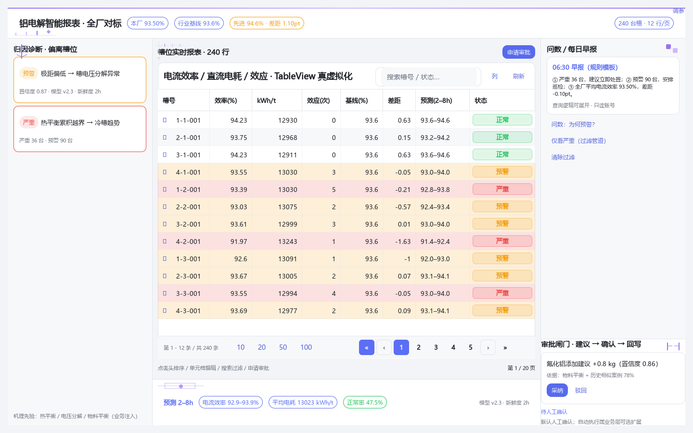
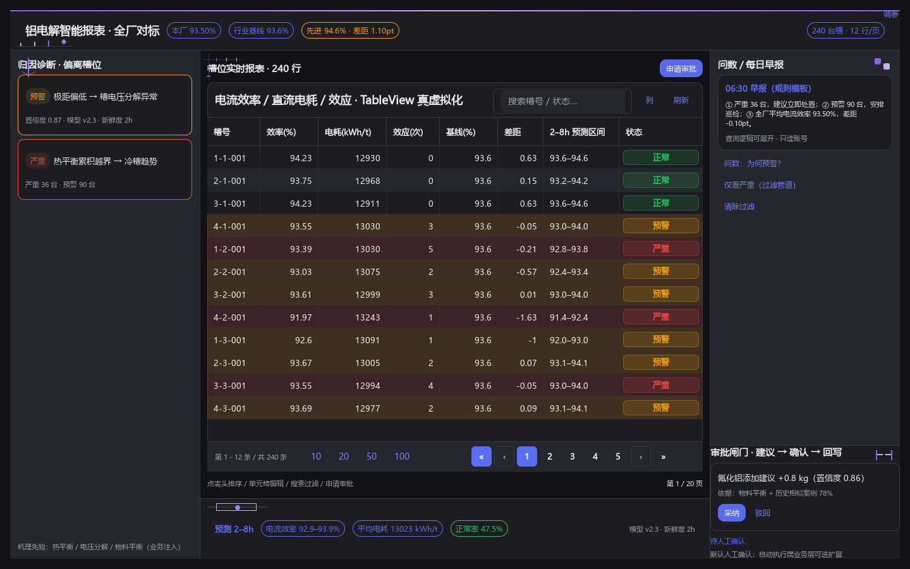
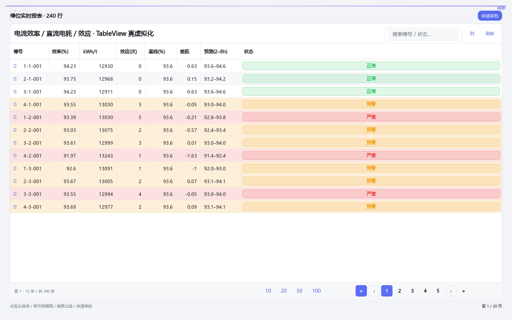

# NovaAIReport · 智能报表工作台

> **模块** `Nova.Composite.LayoutShell` · **分类** 智能报表工作台 · **pyside-nova 1.9.0** · API 冻结指纹 `b15a4be38c000c59` · **21/21 天花板销号** · a11y `decorative`
> 本页由 `scripts/gen_apidocs.py` 从冻结事实源自动生成，**禁止手工编辑**；重跑生成器即可同步。

## 概览

NovaAIReport 智能报表工作台壳：对标带 + 诊断轨 + 主报表区 + 预测区间带 + 问数轨 + 审批闸门 + 浮层 组合态（宪法第 9 章 CC-1~CC-8）：根内 _ 私有 readonly 声明唯一组合上下文，全槽共享； 相邻边界只有一条 NovaSeparator；身份装饰一律抽象几何（对标游标尺 / 因果鱼骨 / 行列刻度尺 / 置信区间带 / 问数双点 / 闸门横闩 / 单色系发丝），不仿交互控件、不撞色；

- **身份**：对标带四级基准游标尺（主轴 + 三档刻 + 偏差游标）；左栏因果鱼骨（竖干 + 三对斜枝）；中栏行列刻度尺（横纵轴 + 行列刻点）；预测带置信区间带（主轴 + 上下界 + 中心点）；右栏问数双点（双实心方点 + 连接线）；审批栏闸门横闩（双立柱 + 横闩 + 缺口）；顶层单色系递进发丝——与既有 20 项身份互不重复
- **依赖组件**：`NovaTheme`、`NovaHeader`、`NovaFooter`、`NovaPage`、`NovaSeparator`、`NovaMotion（推荐注入 `NovaDataGrid` 承载主报表区）`（全部为库内已导出公共类型）
- **天花板销号**：✅ 已销号 · 1.6.0 智能报表工作台 · 三态「浅 / 深 / 变体」
- **台账备注**：七槽无业务语义骨架（对标带 / 诊断轨 / 主报表区 / 预测区间带 / 问数轨 / 审批闸门 / 浮层）+ 3 受控信号 + 3 函数 + 对标游标尺/因果鱼骨/行列刻度尺/置信区间带/问数双点/闸门横闩/单色系发丝差异化身份；参数语义层 / 归因引擎 / 预测模型 / NL2SQL / Agent 编排全由业务槽位注入；`reportSlot` 推荐注入 `NovaDataGrid`；第 21 个组合根 · additive 并入未发布 1.5.0 整批单次重签
- **源码**：`Nova/Composite/LayoutShell/NovaAIReport.qml`

## Props

| 属性 | 类型 | 默认值 |
|---|---|---|
| `approvalHeight` | `int` | `180` |
| `benchmarkHeight` | `int` | `64` |
| `bordered` | `bool` | `true` |
| `breakpoint` | `int` | `1180` |
| `diagnosisCollapsed` | `bool` | `false` |
| `diagnosisSize` | `real` | `300` |
| `forecastHeight` | `int` | `96` |
| `queryCollapsed` | `bool` | `false` |
| `querySize` | `real` | `340` |
| `belowBreakpoint` *(只读)* | `bool` | `width > 0 && width < root.breakpoint` |
| `showApproval` | `bool` | `true` |
| `showBenchmark` | `bool` | `true` |
| `showDiagnosis` | `bool` | `true` |
| `showForecast` | `bool` | `true` |
| `showQuery` | `bool` | `true` |

## Slots

| 槽位 | 类型 | 说明 |
|---|---|---|
| `approvalSlot` | `alias` | 业务内容注入槽；顶层须 `anchors.fill: parent`（CC-6） |
| `benchmarkSlot` | `alias` | 业务内容注入槽；顶层须 `anchors.fill: parent`（CC-6） |
| `diagnosisSlot` | `alias` | 业务内容注入槽；顶层须 `anchors.fill: parent`（CC-6） |
| `forecastSlot` | `alias` | 业务内容注入槽；顶层须 `anchors.fill: parent`（CC-6） |
| `overlaySlot` | `alias` | 业务内容注入槽；顶层须 `anchors.fill: parent`（CC-6） |
| `querySlot` | `alias` | 业务内容注入槽；顶层须 `anchors.fill: parent`（CC-6） |
| `reportSlot` | `alias` | 业务内容注入槽；顶层须 `anchors.fill: parent`（CC-6） |

## Events / Signals

| 信号 | 参数 | 语义 |
|---|---|---|
| `approvalRequested` | — | 组件只 emit，不自写宿主状态 |
| `diagnosisToggled` | `bool collapsed` | 组件只 emit，不自写宿主状态 |
| `queryToggled` | `bool collapsed` | 组件只 emit，不自写宿主状态 |

## Methods

| 方法 | 参数 | 语义 |
|---|---|---|
| `requestApproval` | — | 命令式调用 |
| `toggleDiagnosis` | — | 命令式调用 |
| `toggleQuery` | — | 命令式调用 |

## 最小示例

```qml
import QtQuick
import Nova.Composite.LayoutShell

NovaAIReport {
    anchors.fill: parent

    approvalSlot: Item {
        anchors.fill: parent
        // 业务内容：注入顶层须铺满（CC-6）
    }
}
```

## 三态装配图

> 真实 Qt Quick 引擎渲染；60 张全量索引见 [装配图索引](showcase.md)

| 浅色 | 深色 | 变体 |
|---|---|---|
|  |  |  |

## 相关

- [21 项组合根容器总览](index.md)
- [63 张三态装配图索引](showcase.md)
- [CARF-R 21/21 销号台账](../prescript/AUDIT_CEILING.md)
- [组件清单（147 项）](../COMPONENT_LIST.md)
- [API 冻结清单](../API_FREEZE.md)
