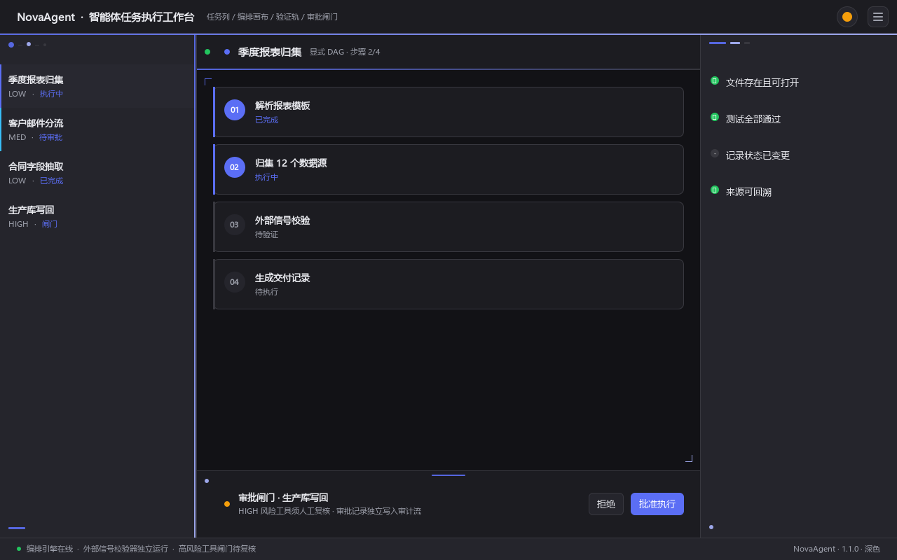
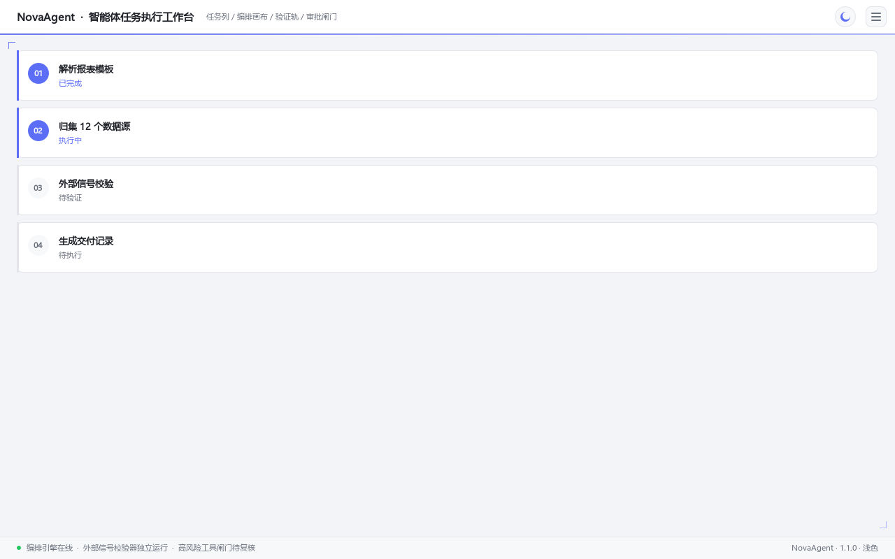

# NovaAgent · 智能体任务执行工作台

> **模块** `Nova.Composite.LayoutShell` · **分类** AI 智能组合根 · **pyside-nova 1.6.0** · API 冻结指纹 `7c542c416709cd96` · **21/21 天花板销号** · a11y `decorative`
> 本页由 `scripts/gen_apidocs.py` 从冻结事实源自动生成，**禁止手工编辑**；重跑生成器即可同步。

## 概览

NovaAgent 智能体任务执行工作台壳：任务列 + 编排画布 + 验证轨 + 审批闸（对标 NovaAgent 八项准入控制） 组合态（宪法第 9 章 CC-1~CC-8）：根内 _ 私有 readonly 声明唯一组合上下文，全轨共享； 相邻边界只有一条 NovaSeparator；身份装饰一律抽象几何（DAG 节点环 / 风险分级色阶 / 闸门色带）， 不仿交互控件、不同屏撞色；折叠锚链恒定不依赖 visible 三元切换。

- **身份**：左任务列 DAG 三节点递减链 + 右缘主色渐变轨；执行画布对角取景框；审批闸门色带；验证轨三段递减级条——与 NovaDE / NovaCopilot 身份互不重复
- **依赖组件**：`NovaTheme`、`NovaHeader`、`NovaFooter`、`NovaPage`、`NovaSeparator`、`NovaMotion`（全部为库内已导出公共类型）
- **天花板销号**：✅ 已销号 · 1.1.0 AI 智能组合根 · 三态「浅 / 深 / 变体」
- **台账备注**：任务列 DAG 链 + 编排画布 + 验证轨 + 审批闸门；八项准入控制由业务注入
- **源码**：`Nova/Composite/LayoutShell/NovaAgent.qml`

## Props

| 属性 | 类型 | 默认值 |
|---|---|---|
| `approvalHeight` | `int` | `96` |
| `bordered` | `bool` | `true` |
| `breakpoint` | `int` | `960` |
| `headerHeight` | `int` | `52` |
| `belowBreakpoint` *(只读)* | `bool` | `width > 0 && width < root.breakpoint` |
| `showApproval` | `bool` | `true` |
| `showPlan` | `bool` | `true` |
| `showTask` | `bool` | `true` |
| `showVerify` | `bool` | `true` |
| `taskCollapsed` | `bool` | `false` |
| `taskSize` | `real` | `280` |
| `verifyCollapsed` | `bool` | `false` |
| `verifySize` | `real` | `300` |

## Slots

| 槽位 | 类型 | 说明 |
|---|---|---|
| `approvalSlot` | `alias` | 业务内容注入槽；顶层须 `anchors.fill: parent`（CC-6） |
| `contentSlot` | `alias` | 业务内容注入槽；顶层须 `anchors.fill: parent`（CC-6） |
| `overlaySlot` | `alias` | 业务内容注入槽；顶层须 `anchors.fill: parent`（CC-6） |
| `planSlot` | `alias` | 业务内容注入槽；顶层须 `anchors.fill: parent`（CC-6） |
| `taskSlot` | `alias` | 业务内容注入槽；顶层须 `anchors.fill: parent`（CC-6） |
| `verifySlot` | `alias` | 业务内容注入槽；顶层须 `anchors.fill: parent`（CC-6） |

## Events / Signals

| 信号 | 参数 | 语义 |
|---|---|---|
| `approvalRequested` | — | 组件只 emit，不自写宿主状态 |
| `taskToggled` | `bool collapsed` | 组件只 emit，不自写宿主状态 |
| `verifyToggled` | `bool collapsed` | 组件只 emit，不自写宿主状态 |

## Methods

| 方法 | 参数 | 语义 |
|---|---|---|
| `requestApproval` | — | 命令式调用 |
| `toggleTask` | — | 命令式调用 |
| `toggleVerify` | — | 命令式调用 |

## 最小示例

```qml
import QtQuick
import Nova.Composite.LayoutShell

NovaAgent {
    anchors.fill: parent

    approvalSlot: Item {
        anchors.fill: parent
        // 业务内容：注入顶层须铺满（CC-6）
    }
}
```

## 三态装配图

> 真实 Qt Quick 引擎渲染；60 张全量索引见 [装配图索引](showcase.md)

| 浅色 | 深色 | 变体 |
|---|---|---|
|  |  |  |

## 相关

- [21 项组合根容器总览](index.md)
- [63 张三态装配图索引](showcase.md)
- [CARF-R 21/21 销号台账](../prescript/AUDIT_CEILING.md)
- [组件清单（147 项）](../COMPONENT_LIST.md)
- [API 冻结清单](../API_FREEZE.md)
