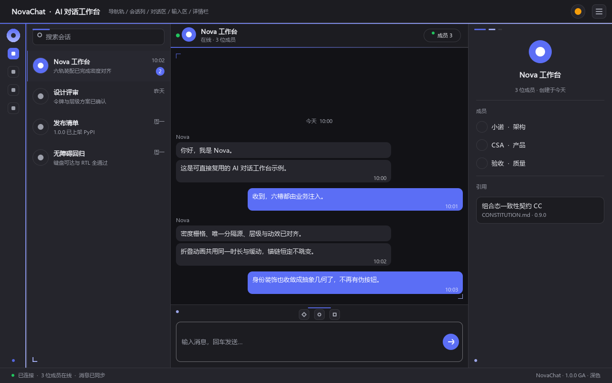
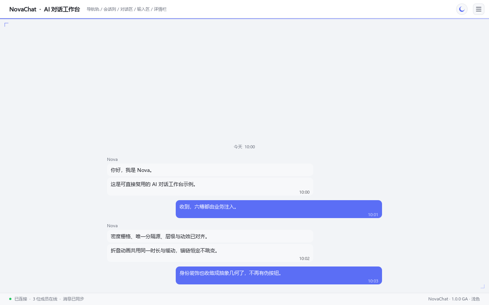

# NovaChat · 六轨按轨分治主窗口

> **模块** `Nova.Composite.LayoutShell` · **分类** AI 对话主窗口 · **pyside-nova 1.10.0** · API 冻结指纹 `5328cd0e3c71e7ac` · **21/21 天花板销号** · a11y `decorative`
> 本页由 `scripts/gen_apidocs.py` 从冻结事实源自动生成，**禁止手工编辑**；重跑生成器即可同步。

## 概览

NovaChat AI 对话主窗口壳：六槽多轨工作台（对标 WorkBuddy 桌面端主窗口），组合态一致性契约（CC）落地标杆 组合态（宪法 0.9.0）：根内以 _ 私有 readonly 声明唯一组合上下文（密度/层级/动效/品牌色），六轨共享； 相邻边界只有一条分隔源；身份装饰一律抽象几何、禁止仿交互控件、同屏品牌色收敛为主色系； 折叠锚链恒定不依赖 visible 三元切换。全部为 _ 私有 PATCH，公共 API 签名逐字不变、冻结指纹不变。

- **身份**：顶层三段品牌发丝线；**每条轨道各有独占且互不重复的前景签名**——
- **依赖组件**：`NovaTheme`、`NovaHeader`、`NovaFooter`、`NovaPage`、`NovaSeparator`、`NovaMotion`（全部为库内已导出公共类型）
- **天花板销号**：✅ 已销号 · 批次 1（0.9.0） · 三态「浅 / 深 / 折叠」
- **台账备注**：六轨标杆；0.9.1 残余 7 处 + CARF 复评三元锚链 1 处已销
- **源码**：`Nova/Composite/LayoutShell/NovaChat.qml`

## Props

| 属性 | 类型 | 默认值 |
|---|---|---|
| `bordered` | `bool` | `true` |
| `breakpoint` | `int` | `960` |
| `composerHeight` | `int` | `132` |
| `conversationCollapsed` | `bool` | `false` |
| `conversationSize` | `real` | `300` |
| `detailCollapsed` | `bool` | `false` |
| `detailSize` | `real` | `320` |
| `headerHeight` | `int` | `52` |
| `navCollapsed` | `bool` | `false` |
| `navSize` | `real` | `64` |
| `belowBreakpoint` *(只读)* | `bool` | `width > 0 && width < root.breakpoint` |
| `showComposer` | `bool` | `true` |
| `showConversation` | `bool` | `true` |
| `showDetail` | `bool` | `true` |
| `showHeader` | `bool` | `true` |
| `showNav` | `bool` | `true` |

## Slots

| 槽位 | 类型 | 说明 |
|---|---|---|
| `composerSlot` | `alias` | 业务内容注入槽；顶层须 `anchors.fill: parent`（CC-6） |
| `contentSlot` | `alias` | 业务内容注入槽；顶层须 `anchors.fill: parent`（CC-6） |
| `conversationSlot` | `alias` | 业务内容注入槽；顶层须 `anchors.fill: parent`（CC-6） |
| `detailSlot` | `alias` | 业务内容注入槽；顶层须 `anchors.fill: parent`（CC-6） |
| `headerSlot` | `alias` | 业务内容注入槽；顶层须 `anchors.fill: parent`（CC-6） |
| `navSlot` | `alias` | 业务内容注入槽；顶层须 `anchors.fill: parent`（CC-6） |
| `overlaySlot` | `alias` | 业务内容注入槽；顶层须 `anchors.fill: parent`（CC-6） |

## Events / Signals

| 信号 | 参数 | 语义 |
|---|---|---|
| `conversationToggled` | `bool collapsed` | 组件只 emit，不自写宿主状态 |
| `detailToggled` | `bool collapsed` | 组件只 emit，不自写宿主状态 |
| `navToggled` | `bool collapsed` | 组件只 emit，不自写宿主状态 |

## Methods

| 方法 | 参数 | 语义 |
|---|---|---|
| `toggleConversation` | — | 命令式调用 |
| `toggleDetail` | — | 命令式调用 |
| `toggleNav` | — | 命令式调用 |

## 最小示例

```qml
import QtQuick
import Nova.Composite.LayoutShell

NovaChat {
    anchors.fill: parent

    composerSlot: Item {
        anchors.fill: parent
        // 业务内容：注入顶层须铺满（CC-6）
    }
}
```

## 三态装配图

> 真实 Qt Quick 引擎渲染；60 张全量索引见 [装配图索引](showcase.md)

| 浅色 | 深色 | 变体 |
|---|---|---|
|  |  |  |

## 相关

- [21 项组合根容器总览](index.md)
- [63 张三态装配图索引](showcase.md)
- [CARF-R 21/21 销号台账](../prescript/AUDIT_CEILING.md)
- [组件清单（147 项）](../COMPONENT_LIST.md)
- [API 冻结清单](../API_FREEZE.md)
