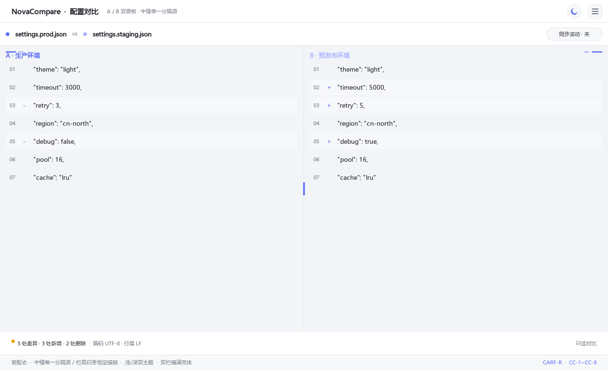
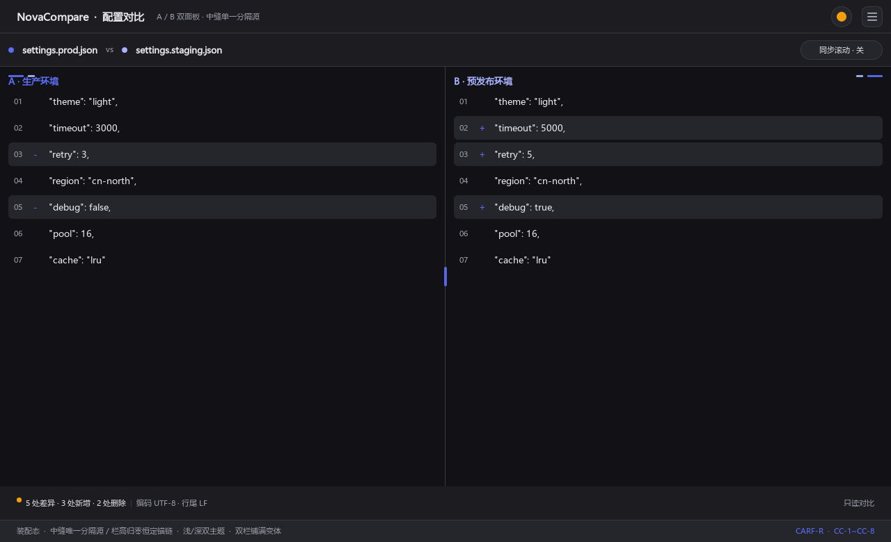
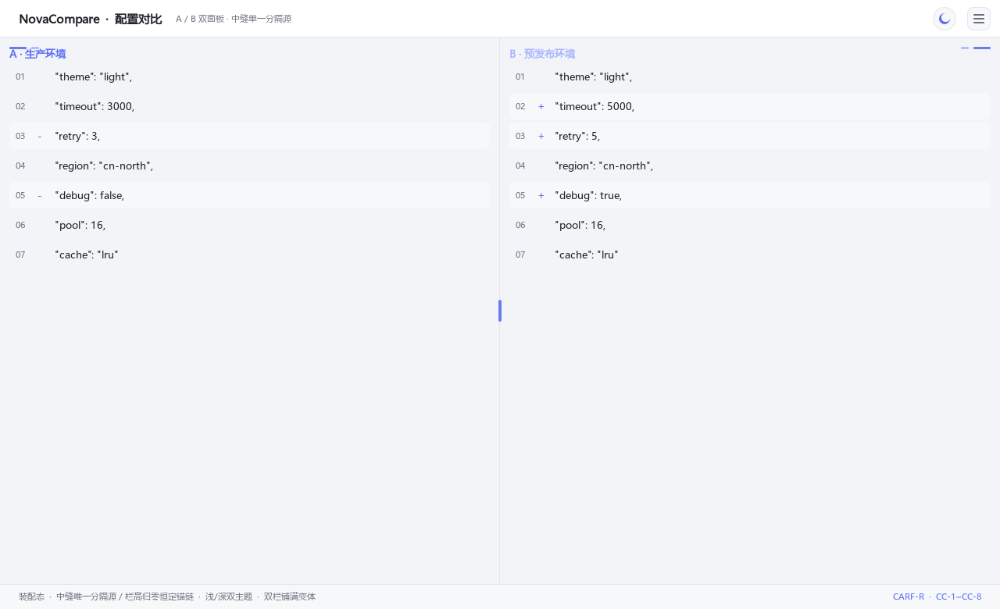

# NovaCompare · 双栏对比壳

> **模块** `Nova.Composite.LayoutShell` · **分类** 多栏工作台 · **pyside-nova 1.2.3** · API 冻结指纹 `4f882374ad52262b` · **20/20 天花板销号** · a11y `decorative`
> 本页由 `scripts/gen_apidocs.py` 从冻结事实源自动生成，**禁止手工编辑**；重跑生成器即可同步。

## 概览

NovaCompare 双栏对比壳：中缝分隔 + 等宽双面板 + 控制栏 + 状态栏（对标代码 / 配置 diff 工具） 组合态（宪法 1.0.0 CARF-R）：_ 私有组合上下文统一密度/层级/动效；栏高归零 + 恒定锚链（CC-5）； A/B 贯穿色条与伪调节柄箭头改为主色系角标 + 抽象短条（CC-2/CC-3）；槽位宿主独立铺满（CC-6）。 用法：向 controlSlot/leftSlot/rightSlot/footerSlot/overlaySlot 注入业务内容；注入顶层须 anchors.fill: parent

- **身份**：A/B 面板标识发丝 + 中缝圆形调节柄（纯几何双向箭头）
- **依赖组件**：`NovaTheme`、`NovaFooter`、`NovaPage`、`NovaSeparator`（全部为库内已导出公共类型）
- **天花板销号**：✅ 已销号 · 批次 4 · 三态「浅 / 深 / 中缝控制」
- **台账备注**：生产 / 预发布配置 diff
- **源码**：`Nova/Composite/LayoutShell/NovaCompare.qml`

## Props

| 属性 | 类型 | 默认值 |
|---|---|---|
| `controlHeight` | `int` | `48` |
| `divider` | `bool` | `true` |
| `footerHeight` | `int` | `48` |
| `showControl` | `bool` | `true` |
| `showFooter` | `bool` | `true` |
| `syncScroll` | `bool` | `false` |

## Slots

| 槽位 | 类型 | 说明 |
|---|---|---|
| `controlSlot` | `alias` | 业务内容注入槽；顶层须 `anchors.fill: parent`（CC-6） |
| `footerSlot` | `alias` | 业务内容注入槽；顶层须 `anchors.fill: parent`（CC-6） |
| `leftSlot` | `alias` | 业务内容注入槽；顶层须 `anchors.fill: parent`（CC-6） |
| `overlaySlot` | `alias` | 业务内容注入槽；顶层须 `anchors.fill: parent`（CC-6） |
| `rightSlot` | `alias` | 业务内容注入槽；顶层须 `anchors.fill: parent`（CC-6） |

## Events / Signals

| 信号 | 参数 | 语义 |
|---|---|---|
| `syncScrollToggled` | `bool enabled` | 组件只 emit，不自写宿主状态 |

## Methods

| 方法 | 参数 | 语义 |
|---|---|---|
| `toggleSyncScroll` | — | 命令式调用 |

## 最小示例

```qml
import QtQuick
import Nova.Composite.LayoutShell

NovaCompare {
    anchors.fill: parent

    controlSlot: Item {
        anchors.fill: parent
        // 业务内容：注入顶层须铺满（CC-6）
    }
}
```

## 三态装配图

> 真实 Qt Quick 引擎渲染；60 张全量索引见 [装配图索引](showcase.md)

| 浅色 | 深色 | 变体 |
|---|---|---|
|  |  |  |

## 相关

- [20 项组合根容器总览](index.md)
- [60 张三态装配图索引](showcase.md)
- [CARF-R 20/20 销号台账](../prescript/AUDIT_CEILING.md)
- [组件清单（144 项）](../COMPONENT_LIST.md)
- [API 冻结清单](../API_FREEZE.md)
