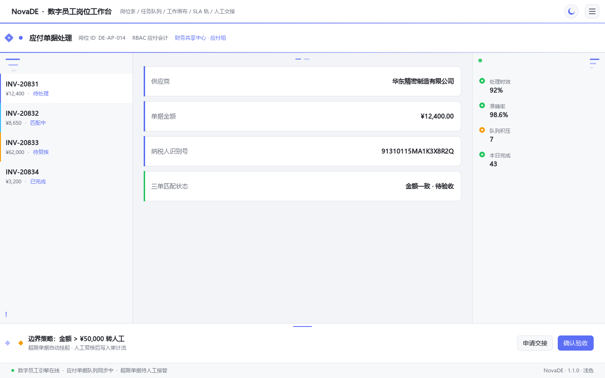
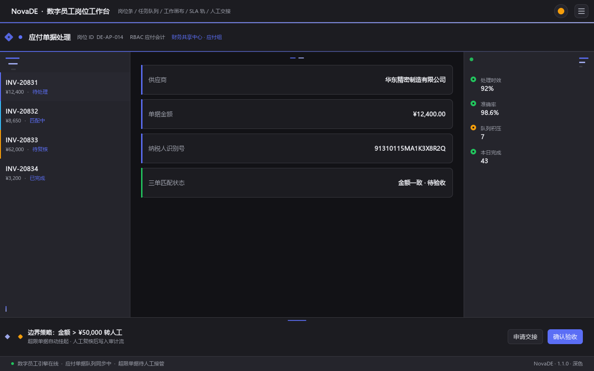
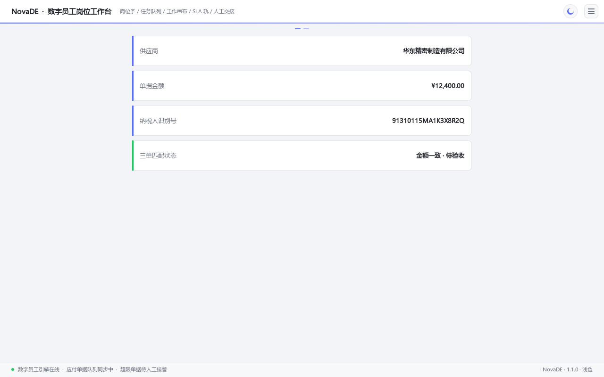

# NovaDE · 数字员工岗位工作台

> **模块** `Nova.Composite.LayoutShell` · **分类** AI 智能组合根 · **pyside-nova 1.8.0** · API 冻结指纹 `89d5d3cdd7f94cf0` · **21/21 天花板销号** · a11y `decorative`
> 本页由 `scripts/gen_apidocs.py` 从冻结事实源自动生成，**禁止手工编辑**；重跑生成器即可同步。

## 概览

NovaDE 数字员工岗位工作台壳：岗位条 + 任务队列 + 工作画布 + SLA 轨 + 人工交接条 （对标 NovaDE 四要件：岗位形态 / 任务队列 / 能力调用 / 队伍级治理） 组合态（宪法第 9 章 CC-1~CC-8）：根内 _ 私有 readonly 声明唯一组合上下文，全部轨共享； 相邻边界只有一条 NovaSeparator；身份装饰一律抽象几何（岗位菱形徽记 / 队列堆叠角标 /

- **身份**：顶部岗位菱形徽记（旋转方形）；左队列分层堆叠卡沿 + 渐变缘轨；工作画布顶部双短条；SLA 轨递减条 + 状态点；交接条双向箭头——与 NovaAgent / NovaCopilot 身份互不重复
- **依赖组件**：`NovaTheme`、`NovaHeader`、`NovaFooter`、`NovaPage`、`NovaSeparator`、`NovaMotion`（全部为库内已导出公共类型）
- **天花板销号**：✅ 已销号 · 1.1.0 AI 智能组合根 · 三态「浅 / 深 / 变体」
- **台账备注**：岗位菱形徽记 + 队列堆叠 + 工作画布 + SLA 轨 + 交接条；四要件由业务注入
- **源码**：`Nova/Composite/LayoutShell/NovaDE.qml`

## Props

| 属性 | 类型 | 默认值 |
|---|---|---|
| `bordered` | `bool` | `true` |
| `breakpoint` | `int` | `1024` |
| `handoffHeight` | `int` | `84` |
| `queueCollapsed` | `bool` | `false` |
| `queueSize` | `real` | `300` |
| `belowBreakpoint` *(只读)* | `bool` | `width > 0 && width < root.breakpoint` |
| `roleHeight` | `int` | `64` |
| `showHandoff` | `bool` | `true` |
| `showQueue` | `bool` | `true` |
| `showRole` | `bool` | `true` |
| `showSla` | `bool` | `true` |
| `slaCollapsed` | `bool` | `false` |
| `slaSize` | `real` | `280` |

## Slots

| 槽位 | 类型 | 说明 |
|---|---|---|
| `contentSlot` | `alias` | 业务内容注入槽；顶层须 `anchors.fill: parent`（CC-6） |
| `handoffSlot` | `alias` | 业务内容注入槽；顶层须 `anchors.fill: parent`（CC-6） |
| `overlaySlot` | `alias` | 业务内容注入槽；顶层须 `anchors.fill: parent`（CC-6） |
| `queueSlot` | `alias` | 业务内容注入槽；顶层须 `anchors.fill: parent`（CC-6） |
| `roleSlot` | `alias` | 业务内容注入槽；顶层须 `anchors.fill: parent`（CC-6） |
| `slaSlot` | `alias` | 业务内容注入槽；顶层须 `anchors.fill: parent`（CC-6） |

## Events / Signals

| 信号 | 参数 | 语义 |
|---|---|---|
| `handoffRequested` | — | 组件只 emit，不自写宿主状态 |
| `queueToggled` | `bool collapsed` | 组件只 emit，不自写宿主状态 |
| `slaToggled` | `bool collapsed` | 组件只 emit，不自写宿主状态 |

## Methods

| 方法 | 参数 | 语义 |
|---|---|---|
| `requestHandoff` | — | 命令式调用 |
| `toggleQueue` | — | 命令式调用 |
| `toggleSla` | — | 命令式调用 |

## 最小示例

```qml
import QtQuick
import Nova.Composite.LayoutShell

NovaDE {
    anchors.fill: parent

    contentSlot: Item {
        anchors.fill: parent
        // 业务内容：注入顶层须铺满（CC-6）
    }
}
```

## 三态装配图

> 真实 Qt Quick 引擎渲染；60 张全量索引见 [装配图索引](showcase.md)

| 浅色 | 深色 | 变体 |
|---|---|---|
|  |  |  |

## 相关

- [21 项组合根容器总览](index.md)
- [63 张三态装配图索引](showcase.md)
- [CARF-R 21/21 销号台账](../prescript/AUDIT_CEILING.md)
- [组件清单（147 项）](../COMPONENT_LIST.md)
- [API 冻结清单](../API_FREEZE.md)
