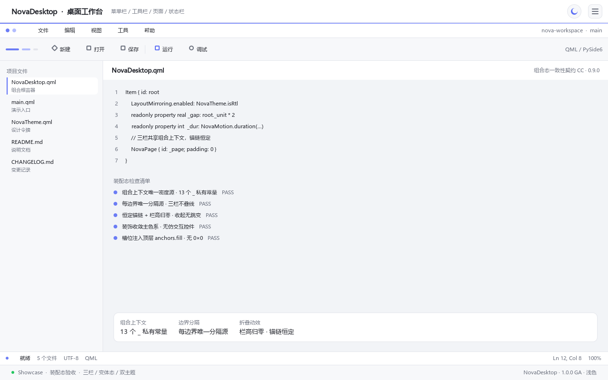
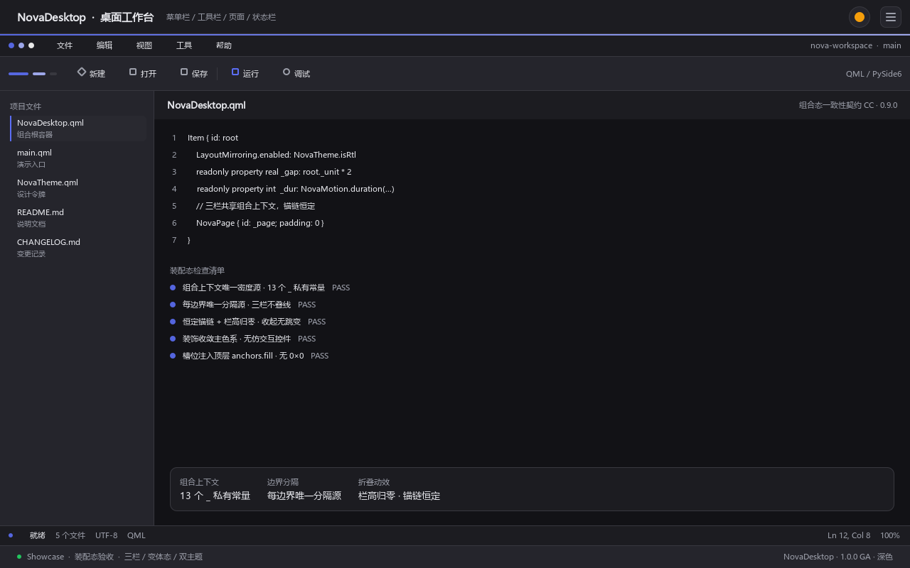
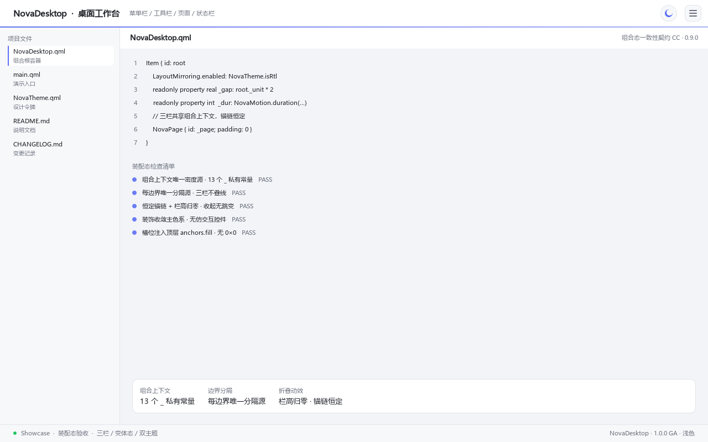

# NovaDesktop · 桌面应用根壳

> **模块** `Nova.Composite.LayoutShell` · **分类** 多端根壳 · **pyside-nova 1.2.1** · API 冻结指纹 `4f882374ad52262b` · **20/20 天花板销号** · a11y `decorative`
> 本页由 `scripts/gen_apidocs.py` 从冻结事实源自动生成，**禁止手工编辑**；重跑生成器即可同步。

## 概览

NovaDesktop 桌面应用根壳：窗口控制点 + 菜单栏 + 工具栏 + 页面 + 状态栏（对标 QMainWindow），组合态一致性契约（CC）落地 组合态（宪法 0.9.0）：_ 私有组合上下文统一三栏密度/层级/动效；栏高归零 + 恒定锚链（CC-5，消除 visible 三元跳变）； 每边界唯一分隔源；三色控制点收敛主色系、仿交互控件方块改抽象几何（CC-3）；槽位宿主铺满（CC-6）。 用法：向 menuSlot/toolbarSlot/pageSlot/statusSlot/overlaySlot 注入业务内容；根节点为应用窗口内容根，不含 ApplicationWindow

- **身份**：三色窗口控制点 + 分层菜单栏 / 工具栏 + 状态指示点
- **依赖组件**：`NovaTheme`、`NovaFooter`、`NovaPage`、`NovaSeparator`（全部为库内已导出公共类型）
- **天花板销号**：✅ 已销号 · 批次 2（0.9.1） · 三态「浅 / 深 / 三栏收起」
- **台账备注**：恒定锚链 + 栏高归零动效；CARF 复评补 `variantMode`
- **源码**：`Nova/Composite/LayoutShell/NovaDesktop.qml`

## Props

| 属性 | 类型 | 默认值 |
|---|---|---|
| `menuHeight` | `int` | `32` |
| `showMenu` | `bool` | `true` |
| `showStatus` | `bool` | `true` |
| `showToolbar` | `bool` | `true` |
| `statusHeight` | `int` | `28` |
| `toolbarHeight` | `int` | `48` |

## Slots

| 槽位 | 类型 | 说明 |
|---|---|---|
| `menuSlot` | `alias` | 业务内容注入槽；顶层须 `anchors.fill: parent`（CC-6） |
| `overlaySlot` | `alias` | 业务内容注入槽；顶层须 `anchors.fill: parent`（CC-6） |
| `pageSlot` | `alias` | 业务内容注入槽；顶层须 `anchors.fill: parent`（CC-6） |
| `statusSlot` | `alias` | 业务内容注入槽；顶层须 `anchors.fill: parent`（CC-6） |
| `toolbarSlot` | `alias` | 业务内容注入槽；顶层须 `anchors.fill: parent`（CC-6） |

## Events / Signals

| 信号 | 参数 | 语义 |
|---|---|---|
| `windowCloseRequested` | — | 组件只 emit，不自写宿主状态 |

## Methods

（该组件无公开方法）

## 最小示例

```qml
import QtQuick
import Nova.Composite.LayoutShell

NovaDesktop {
    anchors.fill: parent

    menuSlot: Item {
        anchors.fill: parent
        // 业务内容：注入顶层须铺满（CC-6）
    }
}
```

## 三态装配图

> 真实 Qt Quick 引擎渲染；60 张全量索引见 [装配图索引](showcase.md)

| 浅色 | 深色 | 变体 |
|---|---|---|
|  |  |  |

## 相关

- [20 项组合根容器总览](index.md)
- [60 张三态装配图索引](showcase.md)
- [CARF-R 20/20 销号台账](../prescript/AUDIT_CEILING.md)
- [组件清单（144 项）](../COMPONENT_LIST.md)
- [API 冻结清单](../API_FREEZE.md)
