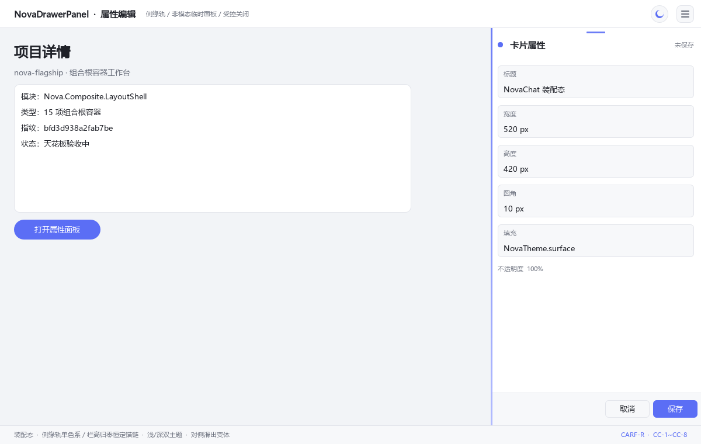
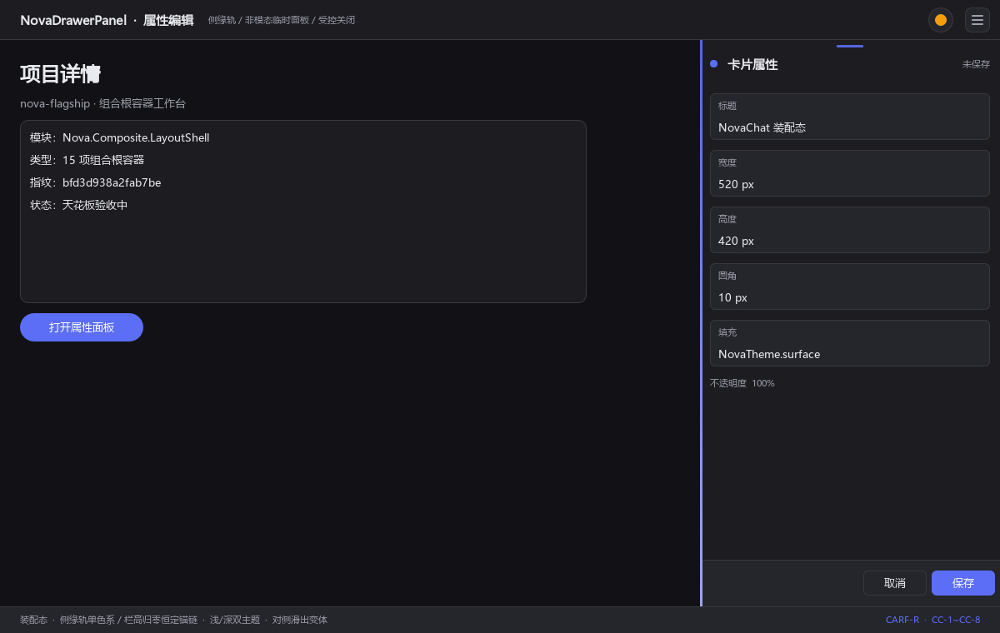
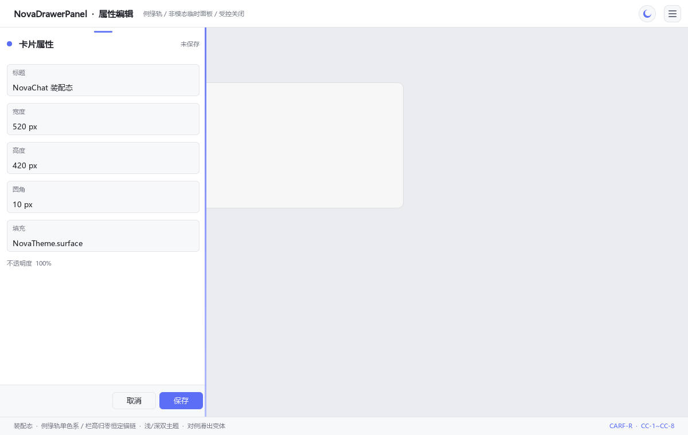

# NovaDrawerPanel · 侧边滑出面板壳

> **模块** `Nova.Composite.LayoutShell` · **分类** 浮层容器 · **pyside-nova 1.2.2** · API 冻结指纹 `4f882374ad52262b` · **20/20 天花板销号** · a11y `decorative`
> 本页由 `scripts/gen_apidocs.py` 从冻结事实源自动生成，**禁止手工编辑**；重跑生成器即可同步。

## 概览

NovaDrawerPanel 侧边滑出面板壳：单色系侧缘轨 + 抽象短条 + 非模态临时面板（区别于常驻 Sidebar） 组合态（宪法 1.0.0 CARF-R）：_ 私有组合上下文统一密度/层级/动效；栏高归零 + 恒定锚链（CC-5）； primary→secondary 撞色轨收敛主色系、伪 grabber 把手改抽象几何（CC-3）；槽位宿主独立铺满（CC-6）。 用法：向 titleSlot/contentSlot/actionsSlot 注入业务内容；注入顶层须 anchors.fill: parent

- **身份**：侧缘渐变轨 + 顶部 grabber 把手
- **依赖组件**：`NovaTheme`、`NovaHeader`、`NovaPage`、`NovaSeparator`（全部为库内已导出公共类型）
- **天花板销号**：✅ 已销号 · 批次 5 · 三态「浅 / 深 / 抽屉对侧」
- **台账备注**：属性编辑抽屉；2 次组件内反向修复
- **源码**：`Nova/Composite/LayoutShell/NovaDrawerPanel.qml`

## Props

| 属性 | 类型 | 默认值 |
|---|---|---|
| `actionsHeight` | `int` | `56` |
| `open` | `bool` | `false` |
| `bySide` *(只读)* | `string` | `NovaTheme.isRtl ? (root.side === "left" ? "right" : "left") : root.side` |
| `scrim` | `bool` | `false` |
| `showActions` | `bool` | `false` |
| `showTitle` | `bool` | `true` |
| `side` | `string` | `"right"` |
| `size` | `real` | `360` |
| `titleHeight` | `int` | `52` |

## Slots

| 槽位 | 类型 | 说明 |
|---|---|---|
| `actionsSlot` | `alias` | 业务内容注入槽；顶层须 `anchors.fill: parent`（CC-6） |
| `contentSlot` | `alias` | 业务内容注入槽；顶层须 `anchors.fill: parent`（CC-6） |
| `titleSlot` | `alias` | 业务内容注入槽；顶层须 `anchors.fill: parent`（CC-6） |

## Events / Signals

| 信号 | 参数 | 语义 |
|---|---|---|
| `closeRequested` | — | 组件只 emit，不自写宿主状态 |

## Methods

| 方法 | 参数 | 语义 |
|---|---|---|
| `requestClose` | — | 命令式调用 |

## 最小示例

```qml
import QtQuick
import Nova.Composite.LayoutShell

NovaDrawerPanel {
    anchors.fill: parent

    actionsSlot: Item {
        anchors.fill: parent
        // 业务内容：注入顶层须铺满（CC-6）
    }
}
```

## 三态装配图

> 真实 Qt Quick 引擎渲染；60 张全量索引见 [装配图索引](showcase.md)

| 浅色 | 深色 | 变体 |
|---|---|---|
|  |  |  |

## 相关

- [20 项组合根容器总览](index.md)
- [60 张三态装配图索引](showcase.md)
- [CARF-R 20/20 销号台账](../prescript/AUDIT_CEILING.md)
- [组件清单（144 项）](../COMPONENT_LIST.md)
- [API 冻结清单](../API_FREEZE.md)
