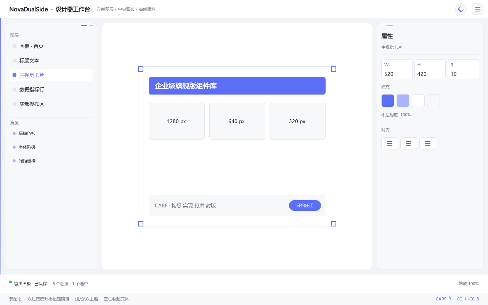
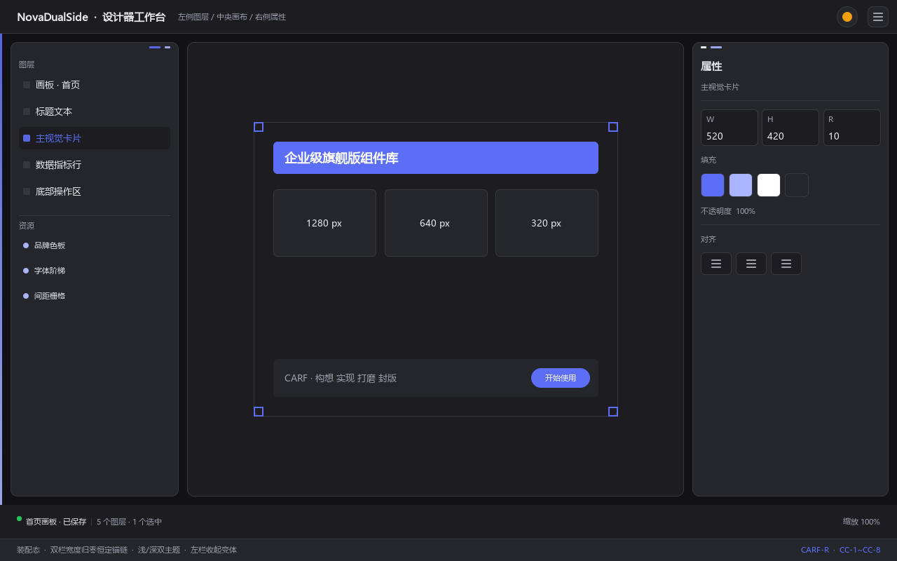
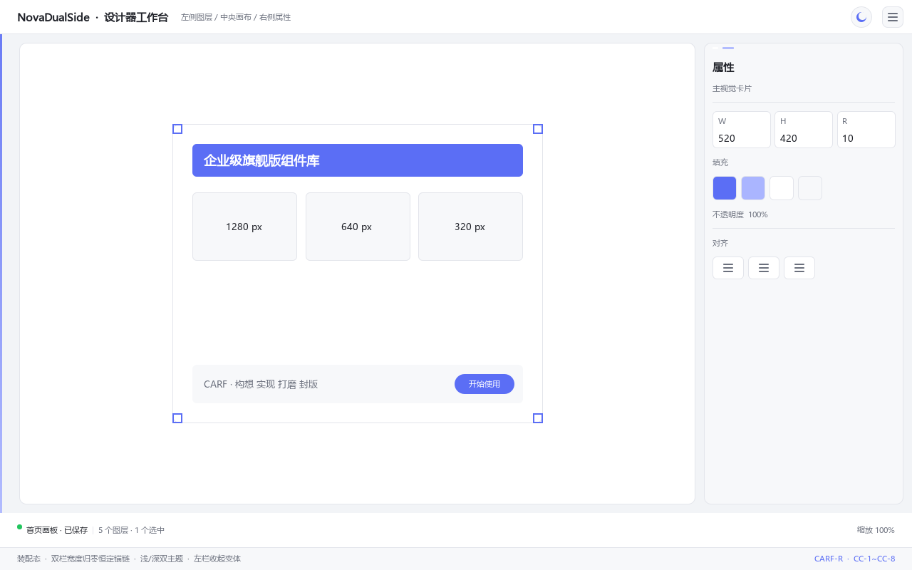

# NovaDualSide · 双侧边工作台

> **模块** `Nova.Composite.LayoutShell` · **分类** 主导航 · **pyside-nova 1.11.0** · API 冻结指纹 `9966483dda5a53c4` · **21/21 天花板销号** · a11y `decorative`
> 本页由 `scripts/gen_apidocs.py` 从冻结事实源自动生成，**禁止手工编辑**；重跑生成器即可同步。

## 概览

NovaDualSide 双侧边工作台壳：左导航 + 中央画布 + 右属性，两侧独立折叠（对标 Qt Designer / VSCode 三栏布局） 组合态（宪法 1.0.0 CARF-R）：_ 私有组合上下文统一密度/层级/动效；两侧宽度归零 + 恒定锚链（CC-5）； primary/secondary 撞色标识收敛主色系角标（CC-3）；每边界唯一分隔源；槽位宿主独立铺满（CC-6）。 用法：向 leftSlot/contentSlot/rightSlot/footerSlot/overlaySlot 注入业务内容；注入顶层须 anchors.fill: parent

- **身份**：中央画布点阵网格 + 左右浮起栏（primary / secondary 顶部标识）
- **依赖组件**：`NovaTheme`、`NovaFooter`、`NovaPage`、`NovaMotion`（全部为库内已导出公共类型）
- **天花板销号**：✅ 已销号 · 批次 3 · 三态「浅 / 深 / 双侧收起」
- **台账备注**：设计器工作台；四角取景框恒定 `x/y`
- **源码**：`Nova/Composite/LayoutShell/../NovaDualSide.qml`

## Props

| 属性 | 类型 | 默认值 |
|---|---|---|
| `bordered` | `bool` | `true` |
| `footerHeight` | `int` | `48` |
| `leftCollapsed` | `bool` | `false` |
| `leftSize` | `real` | `240` |
| `rightCollapsed` | `bool` | `false` |
| `rightSize` | `real` | `280` |
| `showFooter` | `bool` | `true` |

## Slots

| 槽位 | 类型 | 说明 |
|---|---|---|
| `contentSlot` | `alias` | 业务内容注入槽；顶层须 `anchors.fill: parent`（CC-6） |
| `footerSlot` | `alias` | 业务内容注入槽；顶层须 `anchors.fill: parent`（CC-6） |
| `leftSlot` | `alias` | 业务内容注入槽；顶层须 `anchors.fill: parent`（CC-6） |
| `overlaySlot` | `alias` | 业务内容注入槽；顶层须 `anchors.fill: parent`（CC-6） |
| `rightSlot` | `alias` | 业务内容注入槽；顶层须 `anchors.fill: parent`（CC-6） |

## Events / Signals

| 信号 | 参数 | 语义 |
|---|---|---|
| `leftToggled` | `bool collapsed` | 组件只 emit，不自写宿主状态 |
| `rightToggled` | `bool collapsed` | 组件只 emit，不自写宿主状态 |

## Methods

| 方法 | 参数 | 语义 |
|---|---|---|
| `toggleLeft` | — | 命令式调用 |
| `toggleRight` | — | 命令式调用 |

## 最小示例

```qml
import QtQuick
import Nova.Composite.LayoutShell

NovaDualSide {
    anchors.fill: parent

    contentSlot: Item {
        anchors.fill: parent
        // 业务内容：注入顶层须铺满（CC-6）
    }
}
```

## 三态装配图

> 真实 Qt Quick 引擎渲染；60 张全量索引见 [装配图索引](showcase.md)

| 浅色 | 深色 | 变体 |
|---|---|---|
|  |  |  |

## 相关

- [21 项组合根容器总览](index.md)
- [63 张三态装配图索引](showcase.md)
- [CARF-R 21/21 销号台账](../prescript/AUDIT_CEILING.md)
- [组件清单（147 项）](../COMPONENT_LIST.md)
- [API 冻结清单](../API_FREEZE.md)
