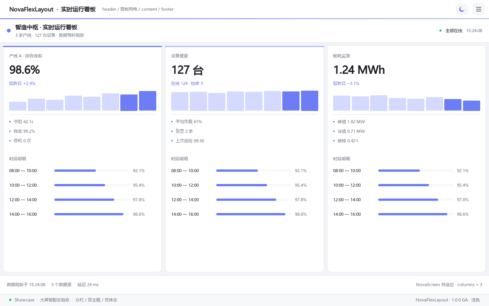
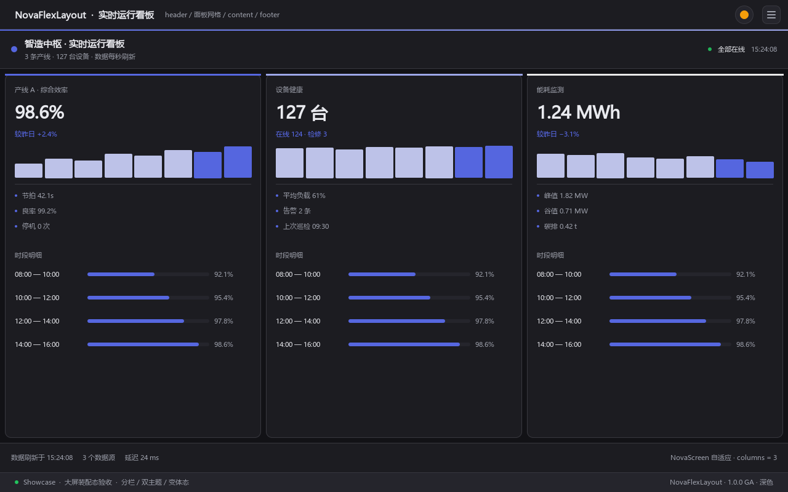
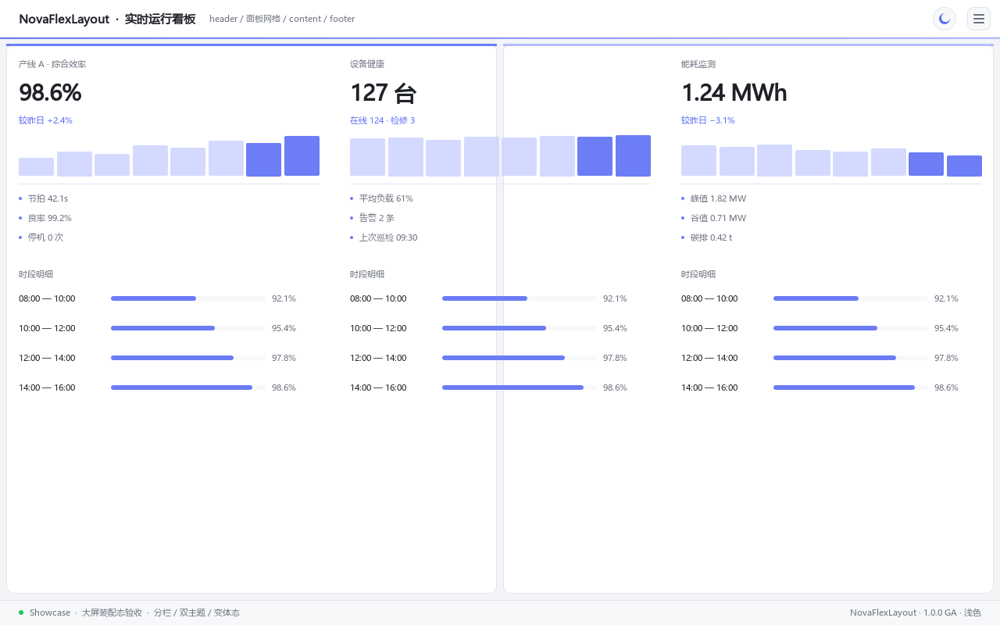

# NovaFlexLayout · 企业大屏弹性布局壳

> **模块** `Nova.Composite.LayoutShell` · **分类** 多端根壳 · **pyside-nova 1.5.0** · API 冻结指纹 `9742de8638251876` · **20/20 天花板销号** · a11y `decorative`
> 本页由 `scripts/gen_apidocs.py` 从冻结事实源自动生成，**禁止手工编辑**；重跑生成器即可同步。

## 概览

NovaFlexLayout 企业大屏弹性布局壳：columns 驱动的浮起面板网格 + 自适应分栏（HMI / 工控大屏），组合态一致性契约（CC）落地 组合态（宪法 0.9.0）：_ 私有组合上下文统一网格密度/层级/动效；header/footer 高度归零 + 恒定锚链（CC-5）； 三色渐变底线与三色面板顶条收敛主色系（CC-3）；每边界唯一分隔源；槽位宿主铺满（CC-6）。 用法：向 headerSlot/contentSlot/footerSlot/overlaySlot 注入业务内容；columns 与断点驱动分栏，缩放取 NovaScreen

- **身份**：`columns` 驱动的浮起面板网格 + 三色面板顶条（提级至 `zMarginals`）
- **依赖组件**：`NovaTheme`、`NovaHeader`、`NovaFooter`、`NovaPage`、`NovaScreen`（全部为库内已导出公共类型）
- **天花板销号**：✅ 已销号 · 批次 2（0.9.1） · 三态「浅 / 深 / 两栏变体」
- **台账备注**：单色系面板网格 + 分栏平滑过渡
- **源码**：`Nova/Composite/LayoutShell/NovaFlexLayout.qml`

## Props

| 属性 | 类型 | 默认值 |
|---|---|---|
| `columns` | `int` | `3` |
| `footerHeight` | `int` | `48` |
| `gap` | `int` | `8` |
| `headerHeight` | `int` | `64` |
| `scalable` | `bool` | `true` |
| `showFooter` | `bool` | `false` |
| `showHeader` | `bool` | `true` |

## Slots

| 槽位 | 类型 | 说明 |
|---|---|---|
| `contentSlot` | `alias` | 业务内容注入槽；顶层须 `anchors.fill: parent`（CC-6） |
| `footerSlot` | `alias` | 业务内容注入槽；顶层须 `anchors.fill: parent`（CC-6） |
| `headerSlot` | `alias` | 业务内容注入槽；顶层须 `anchors.fill: parent`（CC-6） |
| `overlaySlot` | `alias` | 业务内容注入槽；顶层须 `anchors.fill: parent`（CC-6） |

## Events / Signals

| 信号 | 参数 | 语义 |
|---|---|---|
| `layoutChanged` | `int columns` | 组件只 emit，不自写宿主状态 |

## Methods

（该组件无公开方法）

## 最小示例

```qml
import QtQuick
import Nova.Composite.LayoutShell

NovaFlexLayout {
    anchors.fill: parent

    contentSlot: Item {
        anchors.fill: parent
        // 业务内容：注入顶层须铺满（CC-6）
    }
}
```

## 三态装配图

> 真实 Qt Quick 引擎渲染；60 张全量索引见 [装配图索引](showcase.md)

| 浅色 | 深色 | 变体 |
|---|---|---|
|  |  |  |

## 相关

- [20 项组合根容器总览](index.md)
- [60 张三态装配图索引](showcase.md)
- [CARF-R 20/20 销号台账](../prescript/AUDIT_CEILING.md)
- [组件清单（146 项）](../COMPONENT_LIST.md)
- [API 冻结清单](../API_FREEZE.md)
