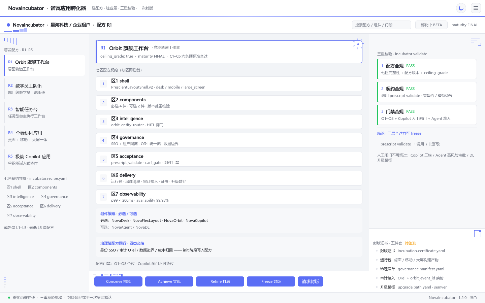
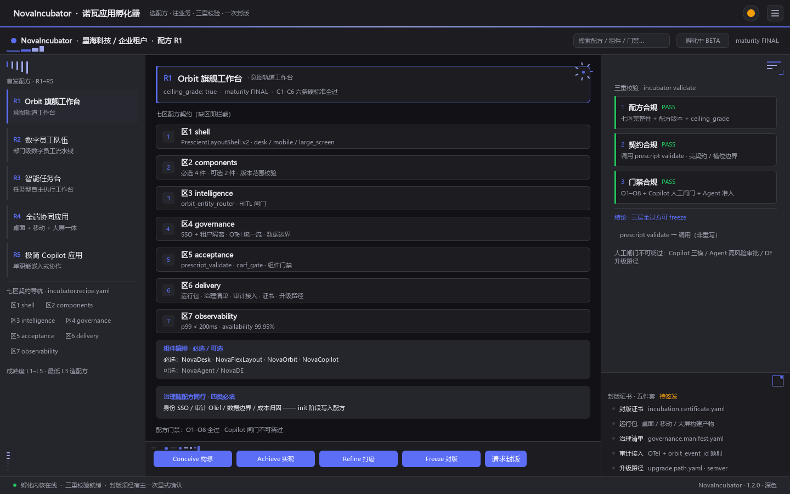
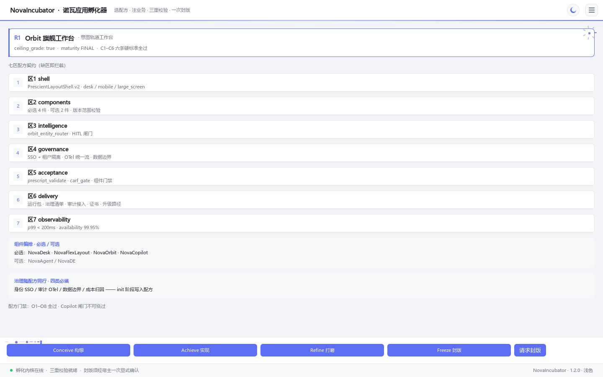

# NovaIncubator · 应用孵化器工作台

> **模块** `Nova.Composite.LayoutShell` · **分类** 应用孵化器工作台 · **pyside-nova 1.4.0** · API 冻结指纹 `37fbbe9ab5806a2a` · **20/20 天花板销号** · a11y `decorative`
> 本页由 `scripts/gen_apidocs.py` 从冻结事实源自动生成，**禁止手工编辑**；重跑生成器即可同步。

## 概览

NovaIncubator 应用孵化器工作台壳：全局栏 + 配方库 + 孵化舞台 + CARF 四阶段条 + 三重校验 + 封版证书 + 浮层 组合态（宪法第 9 章 CC-1~CC-8）：根内 _ 私有 readonly 声明唯一组合上下文，全槽共享； 相邻边界只有一条 NovaSeparator；身份装饰一律抽象几何（递进楔形 / 五列配方栅 / 七区分格环 / 四节点收敛链 / 三道校验刻线 / 方章折角），不仿交互控件、不同屏撞色；折叠锚链恒定。

- **身份**：全局栏四级递进楔形条；左栏五列配方栅 + 列尾七刻点；中栏七区分格环 + 中心孵化点；阶段条四节点收敛链；右栏三道递减校验刻线 + 收敛角；证书栏方章折角 + 封蜡点——与既有 19 项身份互不重复
- **依赖组件**：`NovaTheme`、`NovaHeader`、`NovaFooter`、`NovaPage`、`NovaSeparator`、`NovaMotion`（全部为库内已导出公共类型）
- **天花板销号**：✅ 已销号 · 1.2.0 应用孵化器工作台（收官件） · 三态「浅 / 深 / 变体」
- **台账备注**：七槽无业务语义骨架（全局栏 / 配方库 / 孵化舞台 / CARF 四阶段条 / 三重校验 / 封版证书 / 浮层）+ 3 受控信号 + 3 函数 + 递进楔形/配方栅/七区环/收敛链/校验刻线/方章折角差异化身份；配方解释器 / 组件装配器 / 治理注入器 / 三重校验器 / 证书签发器全由业务注入；**本库第 20 个、最后一个组合组件**；三态图实测暴露 3 处业务注入争位 → 业务侧调参销号、组件公共面零改动
- **源码**：`Nova/Composite/LayoutShell/NovaIncubator.qml`

## Props

| 属性 | 类型 | 默认值 |
|---|---|---|
| `bordered` | `bool` | `true` |
| `breakpoint` | `int` | `1100` |
| `certificateHeight` | `int` | `160` |
| `emblemClickable` | `bool` | `false` |
| `emblemToolTip` | `string` | `""` |
| `globalHeight` | `int` | `52` |
| `pipelineHeight` | `int` | `64` |
| `recipeCollapsed` | `bool` | `false` |
| `recipeSize` | `real` | `260` |
| `belowBreakpoint` *(只读)* | `bool` | `width > 0 && width < root.breakpoint` |
| `showCertificate` | `bool` | `true` |
| `showGlobal` | `bool` | `true` |
| `showPipeline` | `bool` | `true` |
| `showRecipe` | `bool` | `true` |
| `showValidate` | `bool` | `true` |
| `validateCollapsed` | `bool` | `false` |
| `validateSize` | `real` | `340` |

## Slots

| 槽位 | 类型 | 说明 |
|---|---|---|
| `certificateSlot` | `alias` | 业务内容注入槽；顶层须 `anchors.fill: parent`（CC-6） |
| `globalSlot` | `alias` | 业务内容注入槽；顶层须 `anchors.fill: parent`（CC-6） |
| `overlaySlot` | `alias` | 业务内容注入槽；顶层须 `anchors.fill: parent`（CC-6） |
| `pipelineSlot` | `alias` | 业务内容注入槽；顶层须 `anchors.fill: parent`（CC-6） |
| `recipeSlot` | `alias` | 业务内容注入槽；顶层须 `anchors.fill: parent`（CC-6） |
| `stageSlot` | `alias` | 业务内容注入槽；顶层须 `anchors.fill: parent`（CC-6） |
| `validateSlot` | `alias` | 业务内容注入槽；顶层须 `anchors.fill: parent`（CC-6） |

## Events / Signals

| 信号 | 参数 | 语义 |
|---|---|---|
| `emblemClicked` | — | 组件只 emit，不自写宿主状态 |
| `freezeRequested` | — | 组件只 emit，不自写宿主状态 |
| `recipeToggled` | `bool collapsed` | 组件只 emit，不自写宿主状态 |
| `validateToggled` | `bool collapsed` | 组件只 emit，不自写宿主状态 |

## Methods

| 方法 | 参数 | 语义 |
|---|---|---|
| `requestFreeze` | — | 命令式调用 |
| `toggleRecipe` | — | 命令式调用 |
| `toggleValidate` | — | 命令式调用 |

## 最小示例

```qml
import QtQuick
import Nova.Composite.LayoutShell

NovaIncubator {
    anchors.fill: parent

    certificateSlot: Item {
        anchors.fill: parent
        // 业务内容：注入顶层须铺满（CC-6）
    }
}
```

## 三态装配图

> 真实 Qt Quick 引擎渲染；60 张全量索引见 [装配图索引](showcase.md)

| 浅色 | 深色 | 变体 |
|---|---|---|
|  |  |  |

## 相关

- [20 项组合根容器总览](index.md)
- [60 张三态装配图索引](showcase.md)
- [CARF-R 20/20 销号台账](../prescript/AUDIT_CEILING.md)
- [组件清单（145 项）](../COMPONENT_LIST.md)
- [API 冻结清单](../API_FREEZE.md)
