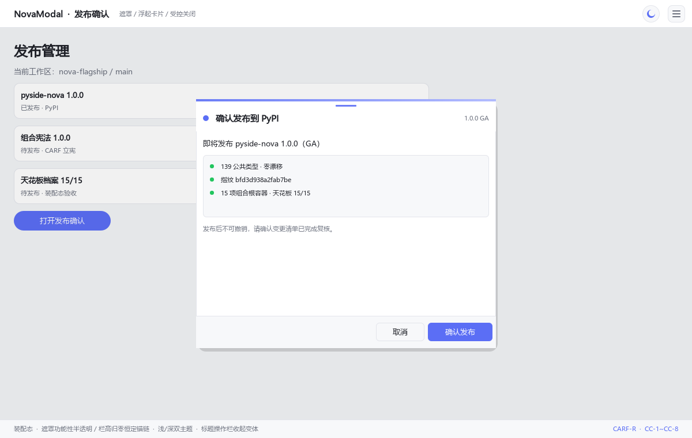
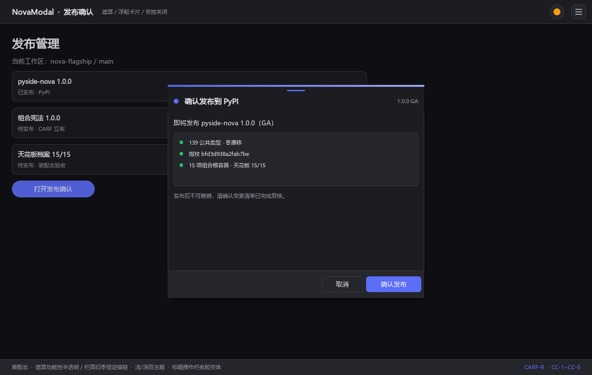
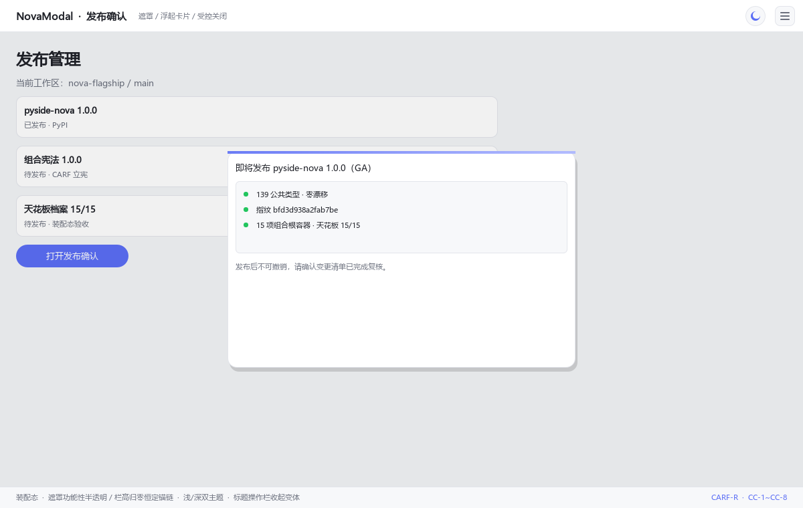

# NovaModal · 模态弹窗壳

> **模块** `Nova.Composite.LayoutShell` · **分类** 浮层容器 · **pyside-nova 1.10.0** · API 冻结指纹 `5328cd0e3c71e7ac` · **21/21 天花板销号** · a11y `decorative`
> 本页由 `scripts/gen_apidocs.py` 从冻结事实源自动生成，**禁止手工编辑**；重跑生成器即可同步。

## 概览

NovaModal 模态弹窗壳：单色系顶条 + 抽象短条 + 浮起卡片 + 遮罩，ESC / 点遮罩关闭（对标 Quasar QDialog） 组合态（宪法 1.0.0 CARF-R）：_ 私有组合上下文统一密度/层级/动效；栏高归零 + 恒定锚链（CC-5）； 三色渐变顶条收敛主色系、伪拖拽把手改抽象几何（CC-3）；槽位宿主独立铺满（CC-6）；遮罩为功能性例外。 用法：向 titleSlot/contentSlot/actionsSlot 注入业务内容；注入顶层须 anchors.fill: parent

- **身份**：顶部三色渐变条 + 拖拽 catcher + 浮起阴影层
- **依赖组件**：`NovaTheme`、`NovaHeader`、`NovaPage`、`NovaSeparator`（全部为库内已导出公共类型）
- **天花板销号**：✅ 已销号 · 批次 5 · 三态「浅 / 深 / 关闭态」
- **台账备注**：PyPI 发布确认；功能性遮罩例外
- **源码**：`Nova/Composite/LayoutShell/NovaModal.qml`

## Props

| 属性 | 类型 | 默认值 |
|---|---|---|
| `actionsHeight` | `int` | `56` |
| `dismissOnMask` | `bool` | `true` |
| `maxHeight` | `real` | `620` |
| `maxWidth` | `real` | `520` |
| `open` | `bool` | `false` |
| `showActions` | `bool` | `true` |
| `showTitle` | `bool` | `true` |
| `titleHeight` | `int` | `52` |

## Slots

| 槽位 | 类型 | 说明 |
|---|---|---|
| `actionsSlot` | `alias` | 业务内容注入槽；顶层须 `anchors.fill: parent`（CC-6） |
| `contentSlot` | `alias` | 业务内容注入槽；顶层须 `anchors.fill: parent`（CC-6） |
| `titleSlot` | `alias` | 业务内容注入槽；顶层须 `anchors.fill: parent`（CC-6） |

## Events / Signals

| 信号 | 参数 | 语义 |
|---|---|---|
| `closeRequested` | `string reason` | 组件只 emit，不自写宿主状态 |

## Methods

| 方法 | 参数 | 语义 |
|---|---|---|
| `requestClose` | `reason` | 命令式调用 |

## 最小示例

```qml
import QtQuick
import Nova.Composite.LayoutShell

NovaModal {
    anchors.fill: parent

    actionsSlot: Item {
        anchors.fill: parent
        // 业务内容：注入顶层须铺满（CC-6）
    }
}
```

## 三态装配图

> 真实 Qt Quick 引擎渲染；60 张全量索引见 [装配图索引](showcase.md)

| 浅色 | 深色 | 变体 |
|---|---|---|
|  |  |  |

## 相关

- [21 项组合根容器总览](index.md)
- [63 张三态装配图索引](showcase.md)
- [CARF-R 21/21 销号台账](../prescript/AUDIT_CEILING.md)
- [组件清单（147 项）](../COMPONENT_LIST.md)
- [API 冻结清单](../API_FREEZE.md)
