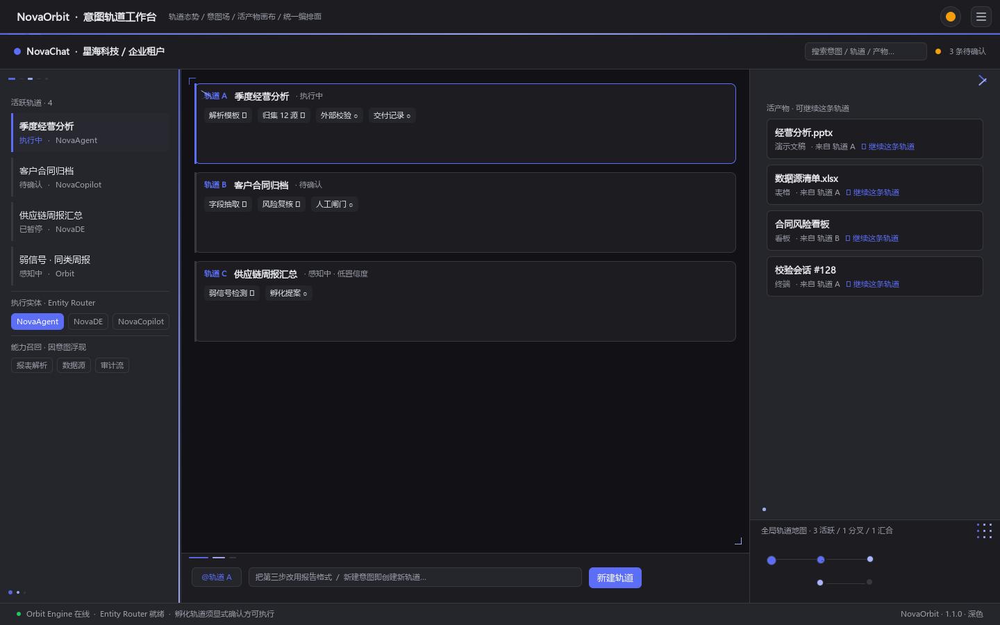
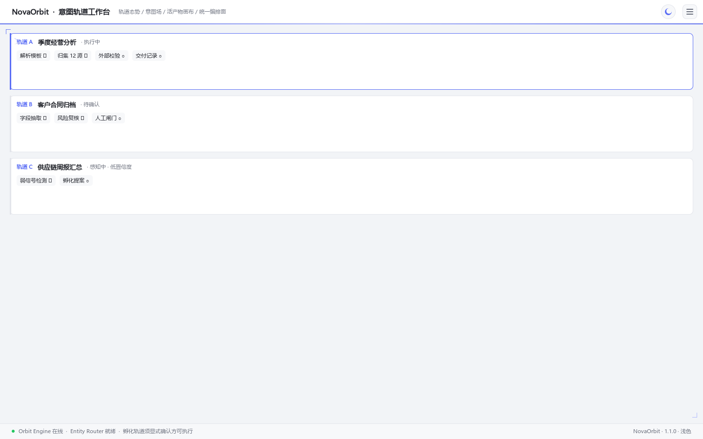

# NovaOrbit · 意图轨道工作台

> **模块** `Nova.Composite.LayoutShell` · **分类** 意图轨道呈现层 · **pyside-nova 1.2.3** · API 冻结指纹 `4f882374ad52262b` · **20/20 天花板销号** · a11y `decorative`
> 本页由 `scripts/gen_apidocs.py` 从冻结事实源自动生成，**禁止手工编辑**；重跑生成器即可同步。

## 概览

NovaOrbit 意图轨道工作台壳：全局栏 + 轨道态势栏 + 意图场 + 活产物画布（NovaChat 天花板形态） 组合态（宪法第 9 章 CC-1~CC-8）：根内 _ 私有 readonly 声明唯一组合上下文，全轨共享； 相邻边界只有一条 NovaSeparator；身份装饰一律抽象几何（轨道发丝线 / 递减轨道链 / 并行分叉角标 / 双向箭头环 / 拓扑点阵），不仿交互控件、不同屏撞色；折叠锚链恒定。

- **身份**：全局栏三段轨道发丝线；左栏递减轨道链 + 感知信号弧点；中栏并行分叉角标 + 对角取景框；右栏双向箭头环 + 拓扑点阵——与 NovaChat 六轨签名及三个 AI 组件身份互不重复
- **依赖组件**：`NovaTheme`、`NovaHeader`、`NovaFooter`、`NovaPage`、`NovaSeparator`、`NovaMotion`（全部为库内已导出公共类型）
- **天花板销号**：✅ 已销号 · 1.1.0 意图轨道呈现层 · 三态「浅 / 深 / 变体」
- **台账备注**：三栏同构异质 + 七槽托管 + 全局栏/输入栏/轨道地图/浮层；Orbit Engine / Entity Router / 孵化确认闸门全由业务注入；第 19 个组合根 · 七件组件收官件
- **源码**：`Nova/Composite/LayoutShell/NovaOrbit.qml`

## Props

| 属性 | 类型 | 默认值 |
|---|---|---|
| `bordered` | `bool` | `true` |
| `breakpoint` | `int` | `1100` |
| `canvasCollapsed` | `bool` | `false` |
| `canvasSize` | `real` | `320` |
| `composerHeight` | `int` | `72` |
| `globalHeight` | `int` | `52` |
| `mapHeight` | `int` | `120` |
| `railCollapsed` | `bool` | `false` |
| `railSize` | `real` | `260` |
| `belowBreakpoint` *(只读)* | `bool` | `width > 0 && width < root.breakpoint` |
| `showCanvas` | `bool` | `true` |
| `showComposer` | `bool` | `true` |
| `showGlobal` | `bool` | `true` |
| `showMap` | `bool` | `true` |
| `showRail` | `bool` | `true` |

## Slots

| 槽位 | 类型 | 说明 |
|---|---|---|
| `canvasSlot` | `alias` | 业务内容注入槽；顶层须 `anchors.fill: parent`（CC-6） |
| `composerSlot` | `alias` | 业务内容注入槽；顶层须 `anchors.fill: parent`（CC-6） |
| `globalSlot` | `alias` | 业务内容注入槽；顶层须 `anchors.fill: parent`（CC-6） |
| `intentSlot` | `alias` | 业务内容注入槽；顶层须 `anchors.fill: parent`（CC-6） |
| `mapSlot` | `alias` | 业务内容注入槽；顶层须 `anchors.fill: parent`（CC-6） |
| `overlaySlot` | `alias` | 业务内容注入槽；顶层须 `anchors.fill: parent`（CC-6） |
| `railSlot` | `alias` | 业务内容注入槽；顶层须 `anchors.fill: parent`（CC-6） |

## Events / Signals

| 信号 | 参数 | 语义 |
|---|---|---|
| `canvasToggled` | `bool collapsed` | 组件只 emit，不自写宿主状态 |
| `orbitRequested` | — | 组件只 emit，不自写宿主状态 |
| `railToggled` | `bool collapsed` | 组件只 emit，不自写宿主状态 |

## Methods

| 方法 | 参数 | 语义 |
|---|---|---|
| `requestOrbit` | — | 命令式调用 |
| `toggleCanvas` | — | 命令式调用 |
| `toggleRail` | — | 命令式调用 |

## 最小示例

```qml
import QtQuick
import Nova.Composite.LayoutShell

NovaOrbit {
    anchors.fill: parent

    canvasSlot: Item {
        anchors.fill: parent
        // 业务内容：注入顶层须铺满（CC-6）
    }
}
```

## 三态装配图

> 真实 Qt Quick 引擎渲染；60 张全量索引见 [装配图索引](showcase.md)

| 浅色 | 深色 | 变体 |
|---|---|---|
|  |  |  |

## 相关

- [20 项组合根容器总览](index.md)
- [60 张三态装配图索引](showcase.md)
- [CARF-R 20/20 销号台账](../prescript/AUDIT_CEILING.md)
- [组件清单（144 项）](../COMPONENT_LIST.md)
- [API 冻结清单](../API_FREEZE.md)
