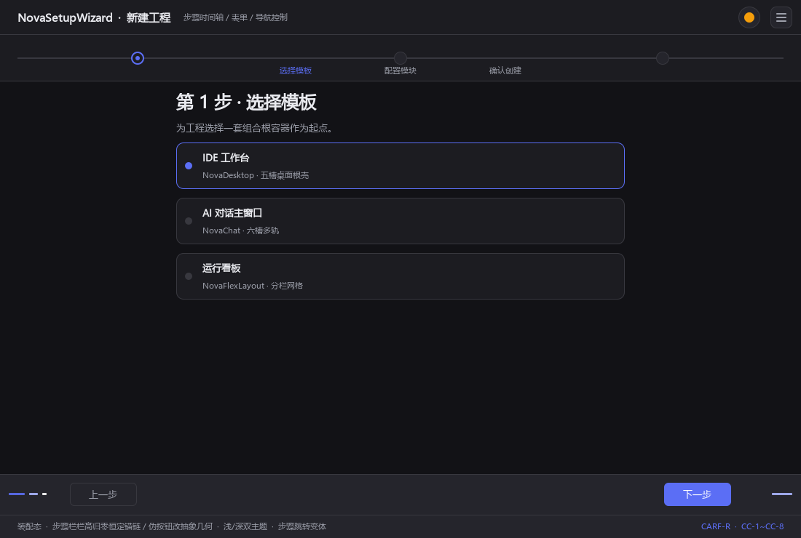

# NovaSetupWizard · 安装配置向导壳

> **模块** `Nova.Composite.LayoutShell` · **分类** 独立页壳 · **pyside-nova 1.9.0** · API 冻结指纹 `b15a4be38c000c59` · **21/21 天花板销号** · a11y `decorative`
> 本页由 `scripts/gen_apidocs.py` 从冻结事实源自动生成，**禁止手工编辑**；重跑生成器即可同步。

## 概览

NovaSetupWizard 安装配置向导壳：三态步骤时间轴 + 当前步内容 + 上一步/下一步控制区（对标 Quasar QStepper） 组合态（宪法 1.0.0 CARF-R）：_ 私有组合上下文统一密度/层级/动效；栏高归零 + 恒定锚链（CC-5）； 两个仿交互控件改抽象几何（CC-3）；业务步骤指示器提级到装饰之上（友好度）；槽位宿主独立铺满（CC-6）。 用法：向 stepsSlot/contentSlot/controlsSlot/footerSlot/overlaySlot 注入业务内容；注入顶层须 anchors.fill: parent

- **身份**：三态步骤时间轴（连接线 + 已完成进度线 + 圆点）+ 控制区按钮位
- **依赖组件**：`NovaTheme`、`NovaFooter`、`NovaPage`、`NovaSeparator`、`NovaMotion`（全部为库内已导出公共类型）
- **天花板销号**：✅ 已销号 · 批次 6 · 三态「浅 / 深 / 步骤跳转」
- **台账备注**：新建工程向导
- **源码**：`Nova/Composite/LayoutShell/NovaSetupWizard.qml`

## Props

| 属性 | 类型 | 默认值 |
|---|---|---|
| `controlsHeight` | `int` | `56` |
| `currentStep` | `int` | `0` |
| `footerHeight` | `int` | `48` |
| `canGoNext` *(只读)* | `bool` | `root.currentStep < root.stepCount - 1` |
| `canGoPrevious` *(只读)* | `bool` | `root.currentStep > 0` |
| `showFooter` | `bool` | `false` |
| `showSteps` | `bool` | `true` |
| `stepCount` | `int` | `3` |
| `stepsHeight` | `int` | `64` |

## Slots

| 槽位 | 类型 | 说明 |
|---|---|---|
| `contentSlot` | `alias` | 业务内容注入槽；顶层须 `anchors.fill: parent`（CC-6） |
| `controlsSlot` | `alias` | 业务内容注入槽；顶层须 `anchors.fill: parent`（CC-6） |
| `footerSlot` | `alias` | 业务内容注入槽；顶层须 `anchors.fill: parent`（CC-6） |
| `overlaySlot` | `alias` | 业务内容注入槽；顶层须 `anchors.fill: parent`（CC-6） |
| `stepsSlot` | `alias` | 业务内容注入槽；顶层须 `anchors.fill: parent`（CC-6） |

## Events / Signals

| 信号 | 参数 | 语义 |
|---|---|---|
| `nextRequested` | — | 组件只 emit，不自写宿主状态 |
| `previousRequested` | — | 组件只 emit，不自写宿主状态 |
| `stepSelected` | `int index` | 组件只 emit，不自写宿主状态 |

## Methods

（该组件无公开方法）

## 最小示例

```qml
import QtQuick
import Nova.Composite.LayoutShell

NovaSetupWizard {
    anchors.fill: parent

    contentSlot: Item {
        anchors.fill: parent
        // 业务内容：注入顶层须铺满（CC-6）
    }
}
```

## 三态装配图

> 真实 Qt Quick 引擎渲染；60 张全量索引见 [装配图索引](showcase.md)

| 浅色 | 深色 | 变体 |
|---|---|---|
|  |  |  |

## 相关

- [21 项组合根容器总览](index.md)
- [63 张三态装配图索引](showcase.md)
- [CARF-R 21/21 销号台账](../prescript/AUDIT_CEILING.md)
- [组件清单（147 项）](../COMPONENT_LIST.md)
- [API 冻结清单](../API_FREEZE.md)
