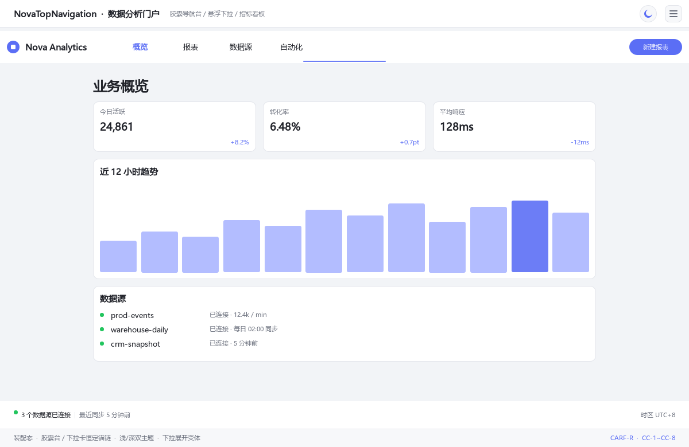
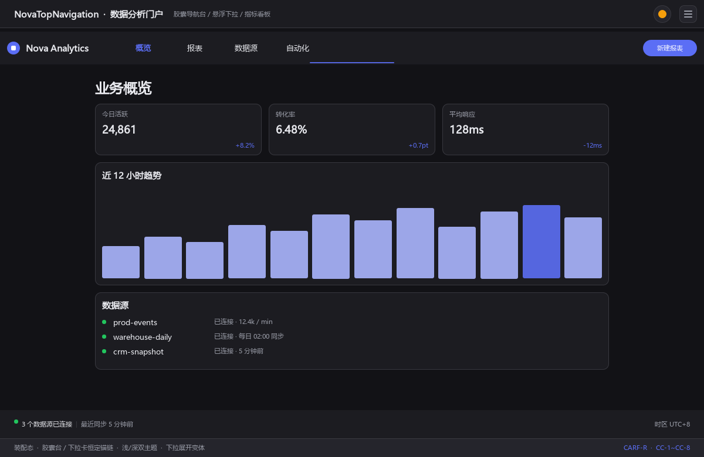
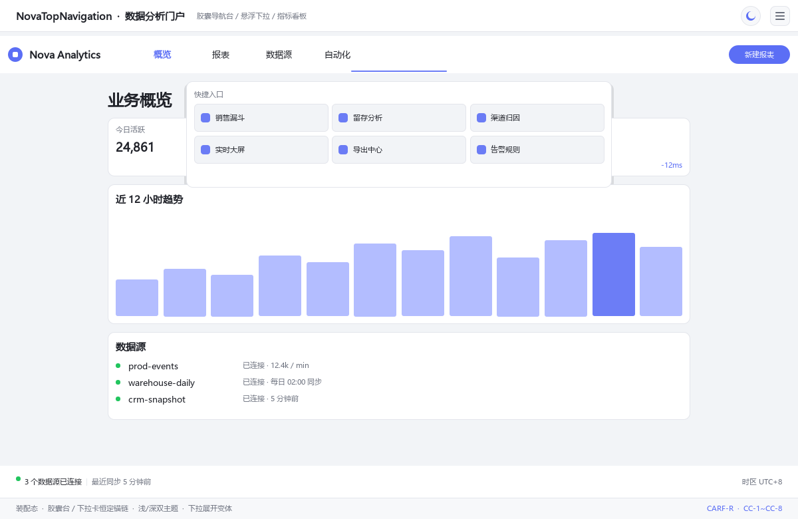

# NovaTopNavigation · 顶部导航工作台

> **模块** `Nova.Composite.LayoutShell` · **分类** 主导航 · **pyside-nova 1.11.0** · API 冻结指纹 `9966483dda5a53c4` · **21/21 天花板销号** · a11y `decorative`
> 本页由 `scripts/gen_apidocs.py` 从冻结事实源自动生成，**禁止手工编辑**；重跑生成器即可同步。

## 概览

NovaTopNavigation 顶部导航工作台壳：胶囊导航台 + 悬浮下拉 + 主内容 + 状态栏（对标 Quasar QLayout header 导航） 组合态（宪法 1.0.0 CARF-R）：_ 私有组合上下文统一密度/层级/动效；栏高归零 + 恒定锚链（CC-5）； 单一分隔源、装饰收敛主色系抽象几何（CC-3）；槽位宿主独立铺满（CC-6）。 用法：向 headerSlot/menuSlot/contentSlot/footerSlot/overlaySlot 注入业务内容；注入顶层须 anchors.fill: parent

- **身份**：胶囊导航台（浮起圆角 header）+ 悬浮下拉卡（阴影 + 边框）
- **依赖组件**：`NovaTheme`、`NovaHeader`、`NovaFooter`、`NovaPage`、`NovaMotion`（全部为库内已导出公共类型）
- **天花板销号**：✅ 已销号 · 批次 3 · 三态「浅 / 深 / 下拉展开」
- **台账备注**：数据分析门户；下拉卡 margins 稳态钳制
- **源码**：`Nova/Composite/LayoutShell/../NovaTopNavigation.qml`

## Props

| 属性 | 类型 | 默认值 |
|---|---|---|
| `footerHeight` | `int` | `48` |
| `headerHeight` | `int` | `56` |
| `menuHeight` | `int` | `160` |
| `menuOpen` | `bool` | `false` |
| `showFooter` | `bool` | `true` |
| `showHeader` | `bool` | `true` |

## Slots

| 槽位 | 类型 | 说明 |
|---|---|---|
| `contentSlot` | `alias` | 业务内容注入槽；顶层须 `anchors.fill: parent`（CC-6） |
| `footerSlot` | `alias` | 业务内容注入槽；顶层须 `anchors.fill: parent`（CC-6） |
| `headerSlot` | `alias` | 业务内容注入槽；顶层须 `anchors.fill: parent`（CC-6） |
| `menuSlot` | `alias` | 业务内容注入槽；顶层须 `anchors.fill: parent`（CC-6） |
| `overlaySlot` | `alias` | 业务内容注入槽；顶层须 `anchors.fill: parent`（CC-6） |

## Events / Signals

| 信号 | 参数 | 语义 |
|---|---|---|
| `menuToggled` | `bool open` | 组件只 emit，不自写宿主状态 |

## Methods

| 方法 | 参数 | 语义 |
|---|---|---|
| `toggleMenu` | — | 命令式调用 |

## 最小示例

```qml
import QtQuick
import Nova.Composite.LayoutShell

NovaTopNavigation {
    anchors.fill: parent

    contentSlot: Item {
        anchors.fill: parent
        // 业务内容：注入顶层须铺满（CC-6）
    }
}
```

## 三态装配图

> 真实 Qt Quick 引擎渲染；60 张全量索引见 [装配图索引](showcase.md)

| 浅色 | 深色 | 变体 |
|---|---|---|
|  |  |  |

## 相关

- [21 项组合根容器总览](index.md)
- [63 张三态装配图索引](showcase.md)
- [CARF-R 21/21 销号台账](../prescript/AUDIT_CEILING.md)
- [组件清单（147 项）](../COMPONENT_LIST.md)
- [API 冻结清单](../API_FREEZE.md)
