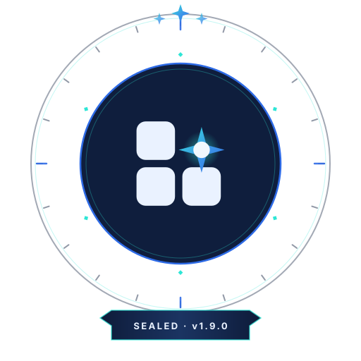

# pyside-nova 文档站首页

<p align="center">
  
  <br/><br/>
  <strong>PySide-Nova，QML 世界的 Quasar。</strong><br/>
  <em>受 Quasar 启发 · 基于 Qt Quick，为 PySide6 而生</em>
</p>

**pyside-nova** 是面向 **PySide6 / QML** 的企业级 UI 组件库，对标 [Quasar Framework](https://quasar.dev)（v2.35.5 基线逐项对账），
当前版本 **1.3.0**（本地完成待 CSA 发布）（1.2.3 之上的 patch 升级：Quasar 品牌 tagline 换回霸气版 + QML 进主标语，**公共 API 零漂移**；**1.2.3**（品牌徽标双轨制落地 + PyPI README 绝对链接修正）与 **1.2.2**（PyPI 元数据 / 双语 README 呈现修正）均已由 CSA 发布至 PyPI；功能主体为 1.0.0 GA 之上的 additive minor——共 **5 项组合根** NovaAgent / NovaDE / NovaCopilot / NovaOrbit / **NovaIncubator（第 20 个、本库最后一个组合组件）** · **144 个导出类型** · **20 个组合根容器 20/20 天花板销号** · 15 项 GA 签名逐字不变 · API 冻结指纹 `4f882374ad52262b` 整批单次重签 · API 契约 `1.2.0` 不变；**1.2.3 已由 CSA 发布至 PyPI（2026-11-26 15:00）**，**1.2.4 已由 CSA 发布至 PyPI（2026-11-26 17:36，LATEST RELEASE）**）。

> **最高方法论 CARF** — Conceive · Achieve · Refine · Freeze（构想 · 实现 · 打磨 · 封版，终抵巅峰）。
> 六维天花板（**功能 / 质量 / 观感 / 友好度 / 四性**：鲁棒性 · 坚实性 · 艺术性 · 预判性）逐项销号；
> 公共 API 冻结指纹 `5328cd0e3c71e7ac`（1.10.0 additive 重签：`NovaTable` 对标 Quasar QTable 打磨；1.8.0 `89d5d3cdd7f94cf0` / 1.7.0 `157ab2b1d77ea9f9` 为史料），147 类型；旧 146 类型逐字不变，15 项 GA 公共签名零漂移。

```python
import sys
from PySide6.QtGui import QGuiApplication
from PySide6.QtQml import QQmlApplicationEngine
from pyside_nova import init_nova

app = QGuiApplication(sys.argv)
engine = QQmlApplicationEngine()
init_nova(engine)          # 注册 Nova.* QML 导入路径
engine.load("main.qml")    # QML 里: import Nova.Controls
```

## 亮点

| 能力 | 说明 |
|---|---|
| **147 个导出类型** | Controls 93 · Behaviors 13 · Services 16 · Design 4 · **Composite.LayoutShell 21**（15 GA + 3 AI 智能组合根 + 1 意图轨道呈现层 + 1 应用孵化器工作台 + 1 智能报表工作台），全部登记 a11y 契约 |
| **21 个组合根容器** | 主导航 4 / 多栏工作台 3 / 浮层容器 2 / 独立页壳 2 / 多端根壳 3 / AI 对话主窗口 1 / **AI 智能组合根 3**（NovaAgent · NovaDE · NovaCopilot）/ **意图轨道呈现层 1**（NovaOrbit）/ **应用孵化器工作台 1**（NovaIncubator · 收官件），九类 21/21 封版 |
| **组合态一致性契约** | CC-1~CC-8 入宪（组合宪法 1.0.0 第 9 章）；一律 `property alias` 槽位、只 emit 不自写宿主状态 |
| **六维天花板 21/21** | CARF-R 全量销号：63 张三态装配图 + `audit_ceiling.py` 21/21 PASS + 极端非法入参稳态几何 + RTL / reducedMotion |
| **API 冻结零漂移** | `api/nova-api-1.10.0.json` 逐成员签名 + `check_api_freeze.py` 门禁；静态门禁 3/3 · 专项 99 passed |
| **可访问性 WCAG 2.1 AA** | AA 派生令牌、全键盘路径、焦点环（focus-visible）、静态 + 运行时双门禁 |
| **国际化 NovaI18n** | locale 切换、CLDR 七语系复数、数字 / 货币 / 日期格式化、RTL 双轨镜像 |
| **性能门禁** | 冷启动 ≤800ms / 组件实例化 ≤5ms / 1000 行表格 ≤1700ms（pytest 门禁承载） |
| **供应链** | CycloneDX SBOM + OSV CVE 周巡 + 外部输入消毒 |
| **AI-ready** | `docs/ai/` 版本精确离线 API 包 + Nova MCP server 六工具，杜绝「基于训练记忆的幻觉 props」 |

## 文档导航

- **[组件分类与架构分层实用指南](prescript/GUIDE_CLASSIFICATION.md)** —— 五模块 146 类型 / 五层概念体系映射 / 20 组合根九类台账 / 按场景选型速查
- **[基础组件域分类与依赖纪律实用指南](prescript/GUIDE_COMPONENT_DOMAINS.md)** —— Controls 七域 91 + Behaviors 三域 13 = 104 基础类型十域台账 / 单向依赖机检守护 / 概念域 ≠ 模块 URI
- **[Quasar 工程化理念对齐与架构演进实用指南](prescript/GUIDE_QUASAR_ALIGNMENT.md)** —— 四大理念 × 1.2.0 逐项对齐 / 命令式服务 `show()` 真实用法速查 / 设计令牌与槽位范式正确引用 / v2.0 已立项（见下条 §5.1）
- **[v2.0 物理重构立项书 · 双轨兼容规范](prescript/SPEC_V2_COMPAT.md)** —— RFC + Qt 七形态实测 / **M1 就绪态（零物理视图）** / 宪法第 9·13 章合规论证 / M1~M4 分批迁移路线图 / 兼容层 C1~C5 机检
- **[企业级旗舰封版徽标规范](prescript/GUIDE_BRAND_MARK.md)** —— 双轨制：克制矢量派（库标 / 站点 / README）+ 鎏金纪念版（宣传封面）；三枚徽标预览 + 升版 SOP（徽标刻当前包版本，每次升版含 patch 同步修正 SVG 版本号）
- **[20 个组合根容器 · 逐组件 API 页](components/index.md)** —— Props / Slots / Events / 依赖组件 / 最小示例 / 三态装配图
- **[63 张三态装配图索引](components/showcase.md)**
- **[CARF-R 20/20 天花板销号台账](prescript/AUDIT_CEILING.md)**
- [白皮书：旗舰组件库](prescript/WHITEPAPER.md) · [Prescient Layout Shell 封版规范](prescript/SPEC_FREEZE.md)
- [架构宪法](CONSTITUTION.md)（母法 · 卷首 CARF · 第 0~13 章） / [组合组件宪法](COMPOSITION_CONSTITUTION.md)（1.0.0 · 第 9 章 CC-1~CC-8）
- [组件清单（146 项）](COMPONENT_LIST.md) / [API 冻结清单](API_FREEZE.md) / [设计令牌](DESIGN_TOKENS.md)
- [国际化指南](I18N.md) · [无障碍](A11Y.md) · [无障碍矩阵](A11Y_MATRIX.md) · [画廊预览](GALLERY.md)
- [Quasar 逐项对账](PARITY.md) / [生态七层对账（历史档案）](ECOSYSTEM_PARITY.md) / [与 Quasar 的关系与致谢（文案事实源）](QUASAR_ACKNOWLEDGEMENT.md)
- [总规划](MASTER_PLAN.md) / [路线图](ROADMAP.md) / [交接快照](SESSION_HANDOFF.md)

## 一分钟跑通画廊

```bash
pip install pyside-nova==1.3.0
# 克隆仓库后：
python examples/gallery_launch.py    # 24 页组件画廊（明暗主题 / 断点 / i18n / RTL）
```
