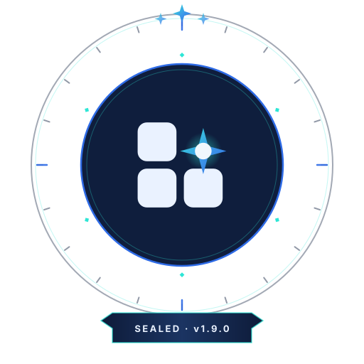
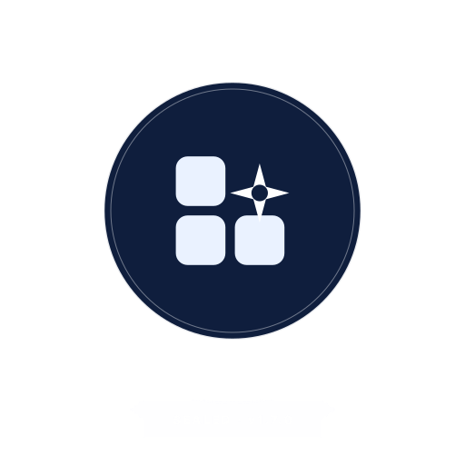
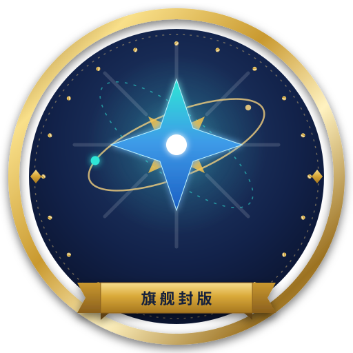

# GUIDE_BRAND_MARK · pyside-nova 品牌徽标规范

> 法源：组合宪法 1.0.0 第 4 条「不将就」· QUASAR_ACKNOWLEDGEMENT（Inspired by 口径）· GUIDE_COMPONENT_THEMES（青出于蓝母题）。
> 立档：2026-11-26 14:22 · CSA 指令「设计企业级旗舰版封版徽标，红花必须绿叶衬」。
> **规则修订：2026-11-26 14:37 · CSA 指令「这是 SVG 文件，每次升版时记得把 SVG 文件的版本号也得修正」**。
> 本文件是徽标语义与使用的**唯一事实源**；徽标视觉以 `src/pyside_nova/resources/icons/` 下 SVG 为准，禁止手改生成式细节以外的语义元素。

> **规则沿革（史料不圆场）**：14:22 立档时口径为「徽标刻 **API 契约版本 1.2**、patch 不动缎带」。
> 14:37 CSA 看过 SVG 源文件后改判：徽标是 SVG 文本、版本号是**可改的文字**，若刻死 API 契约版本，
> 以后升版这枚徽标就作废了。故现行口径改为「**刻当前包版本，每次升版（含 patch）同步修正**」，
> 并由 `scripts/sync_brand_version.py` 机检保障。14:22 旧口径及其历史预览图按史料保留，不回改。

## 1. 设计立意：红花与绿叶

「红花」= 中心 **2×2 组件矩阵 + 青→蓝渐变旗舰星芒 + 极光白芯**，直接继承 `pyside-nova-logo.svg` 的原始血脉——那一枚星芒本身就是「青出于蓝」的工程表达（青 `#2EE6D6` → 蓝 `#2E6BE6`）。

「绿叶」= 外圈**环形封印**：CARF 四词铭文、20 刻度、6 枚青点、三星冠与缎带。绿叶不抢戏，只做衬托与身份声明，让中心的红花更立得住。

这不是另起炉灶的新 logo，而是**在原徽标之外增加一枚「旗舰封版」级封印**——原四款（标准标 / 横版带字 / 单色 / 32px favicon）保持不变，各司其职。

## 2. 语义逐项对照（机检口径入徽）

| 徽标元素 | 对应事实 | 数量 |
|---|---|---|
| 上弧铭文 `CONCEIVE · ACHIEVE · REFINE · FREEZE` | CARF 四阶段（母法卷首 / 组合宪法第 9 章 CC-1~CC-8） | 4 词 |
| 下弧 `PYSIDE-NOVA · FLAGSHIP SEAL · v1.2.3` | 品牌 + 封版身份 + **当前包版本** | 1 行 |
| 外环刻度 | 组合根容器 | **20** |
| 其中 4 枚加粗长刻度 | 正交方位锚点（视觉稳定） | 4 |
| 青色菱形点 | 六维天花板（功能 / 质量 / 观感 / 友好度 / 四性） | **6** |
| 2×2 缺右上矩阵 | 组件矩阵组织哲学，右上格留给旗舰星芒 | 3 实体块 |
| 青→蓝渐变星芒 + 白芯 | 「青出于蓝」+ Aurora Core 极光核 | 1 |
| 顶部三星 | 旗舰封版标识 | 3 |
| 底部缎带 `SEALED · v1.2.3` | 封版状态 + **当前包版本**（升版同步修正，见 §7） | 1 |

**版本口径（现行）**：徽标刻的是 **当前包版本**，随 `__about__.py` 的 `__version__` 走。
**每次升版——包括 patch——都必须同步修正**三枚 SVG 的下弧与缎带版本字样，并同步文档站副本。
版本字样只是 SVG 里的文本节点，改它**不动公共 API、不动冻结面、不动指纹**；
校准动作由 `scripts/sync_brand_version.py` 完成，`--check` 供门禁机检（见 §7）。
API 契约版本（`1.2.0`）另有 `api/nova-api-1.2.0.json` 与 `docs/API_FREEZE.md` 承载，**不再体现在徽标上**。

## 3. 色值（沿用现有品牌色，不引入第 9 色）

| 用途 | 色值 | 说明 |
|---|---|---|
| 深海军蓝（底 / 矩阵原色） | `#0F1E3D` | 原徽标主色 |
| 品牌青 | `#2EE6D6` | 星芒起点 / 六维点 / 刻度点缀 |
| 品牌蓝 | `#2E6BE6` | 星芒终点 / 加粗刻度 / 主盘描边 |
| 过渡蓝 | `#3E9BE8` | 星芒 52% 插值 |
| 浅雾白 | `#EAF2FF` | 矩阵实体块 / 缎带文字 |
| 极光白芯 | `#FFFFFF` | 星芯，Aurora Core 的几何白芯 |

不新增公共主题色，不改 `NovaTheme` 冻结面；徽标色板与 API 冻结面无关。

## 4. 资产清单（CSA 14:22 拍板：双轨制 —— 克制版入库 + 华丽版宣传）

| 文件 | 用途 | 路线 |
|---|---|---|
| `pyside-nova-logo-sealed.svg` | **正式库徽标**，浅色底 / 文档 / 站点 / README | 克制矢量派 |
| `pyside-nova-logo-sealed-mono.svg` | 单色版，深色底 / 印刷 / 烫印（元素同构，星芯反白） | 克制矢量派 |
| `pyside-nova-logo-sealed-gold.svg` | **鎏金纪念版**，宣传海报 / 封面 / 演讲大图，**不作 favicon / 小尺寸** | 华丽宣传派 |
| `pyside-nova-logo.svg` / `-logo1.svg` / `-logo2.svg` / `-logo3.svg` | 原有四款，保持不变 | 官方基础标 |
| `nova-flagship-seal.svg` / `nova-ultimate-seal-*.svg` / `nova-*-seal.svg` | 历史设计资产，鎏金版据此承袭基因 | 史料 |

渲染预览（Chrome 实拍，非设计稿）位于 `docs/screenshots/branding/`。
三枚封版徽标的站点副本位于 `docs/assets/brand/`，由 `sync_brand_version.py` 与源逐字同步。

### 4.1 鎏金纪念版的家族血脉（本节为 CSA 14:22「挑花眼，参考历代徽标」的产物）

CSA 贴出历代 14 枚徽标后拍板双轨制。鎏金版逐项继承 `nova-flagship-seal.svg`：

- **鎏金外环**（`goldRing` 六段渐变 + 投影）、深空蓝径向底盘（`navy`）、左右装饰菱形、金缎带——全部沿用祖先 defs，不另造材质。
- **四长芒主星 + 45° 副星 + 白芯 + 轨道电子**——沿用祖先星系构型；主星填充由祖先金色 `starGrad` 改为家族 **青→蓝 `novaStar`**，实现「青出于蓝」与全套组件同源。
- **双轨道**：金色实线椭圆（`rotate(-22)`，致敬 Quasar）+ 青色虚线椭圆（`rotate(38)`，Aurora 轨道）。
- **新增**：上弧 CARF 四词铭文、20 金点（20 组合根）、下弧拆两段 `PYSIDE-NOVA` / `SEALED · v1.2.3`、缎带「旗舰封版」。

**迭代记录（史料不圆场）**：初版下弧单段长文案被金缎带遮挡；依次尝试缩弧半径、字号 15/13、startOffset 24/76 → 最终定为字号 13、offset 16%/84% 两段，Chrome 复拍完整可读。

### 4.2 落地台账（2026-11-26 14:33 实施 · 14:37 补版本号同步）

| 位置 | 使用的资产 | 呈现方式 | 判定 |
|---|---|---|---|
| `README.md` / `README_zh.md` 顶部 | `pyside-nova-logo-sealed.svg` | 200px，GitHub raw 绝对地址（PyPI 相对链接 404 前车之鉴） | 正式库徽标，双语一致 |
| `docs/index.md` 首页 | `pyside-nova-logo-sealed.svg`（站点副本） | 260px 居中展示 | 站点首屏身份 |
| `mkdocs.yml` favicon | `pyside-nova-logo3.svg`（站点副本 `pyside-nova-icon.svg`） | 32px 基础标 | 按 §5 最小尺寸规则，封版徽标不上 favicon |
| 文档站导航 | 本规范 `GUIDE_BRAND_MARK.md` | 「体系」分组现行项 | 法源可达 |
| 本页 §4.3 | 三枚封版徽标站点副本 | 并排展示 | 双轨制可视化 |
| 宣传海报 / 封面 / 演讲大图 | `pyside-nova-logo-sealed-gold.svg` | ≥160px，Chrome 渲染 | 仅宣传，不入库标 / 小尺寸 |

### 4.3 三枚徽标预览（文档站实际渲染）

| 正式库标（克制矢量派） | 单色版 | 鎏金纪念版（华丽宣传派） |
|---|---|---|
|  |  |  |

> 上表为 SVG 原图直接渲染；`textPath` 环形铭文依赖浏览器 SVG 引擎，QtSvg 不渲染（见 §5.5）。

## 5. 使用规则

1. **最小尺寸**：带铭文版 ≥ 160px（低于此尺寸铭文不可读，改用原 `logo3.svg` 32px 标）。
2. **留白**：四周留白 ≥ 徽标直径的 8%，不得与文字或边框贴合。
3. **禁止**：拉伸变形、改色相、镜像、去掉白芯、替换铭文文字、加阴影/发光特效（徽标自身已含极光白芯，不叠加外发光）。
4. **版本联动**：**每次升版（含 patch）同步修正**下弧与缎带版本字样，脚本见 §7；禁止出现「包已升版、SVG 仍刻旧版本」的账实不符。
5. **渲染注意**：`textPath` 环形铭文依赖浏览器 SVG 引擎；QtSvg（QPainter 路线）不渲染 `textPath`，离线截图请用浏览器内核（Chrome / Playwright）而非 QSvgRenderer。
6. **史料**：已发布版本的历史徽标、历史预览图（如 14:21 那批刻 `API 1.2` 的 PNG）按「史料不圆场」保留，不回改；现行资产以本页与 `sync_brand_version.py --check` 为准。

## 6. 验收记录

**14:21 首版（史料，当时的版本字样为 `API 1.2`，按史料不圆场保留原文）**

- XML 解析：两枚 SVG 均通过 `ElementTree.parse`。
- Chrome 实拍：上弧 CARF 四词、下弧品牌版本、20 刻度、6 青点、矩阵星芒白芯、顶部三星、缎带文字全部完整无裁切。
- 修正记录：初版缎带 `SEALED · FLAGSHIP · API 1.2` 末尾被箭头压住且与下弧重复，精简为 `SEALED · API 1.2` 后复拍通过。

**14:37 版本口径修订（现行）**

- CSA 指令把「刻 API 契约版本、patch 不动」改判为「刻包版本、每次升版同步修正」。
- `scripts/sync_brand_version.py` 一次性把 3 枚源 SVG + 3 份站点副本共 **5 处版本字样**同步为 `v1.2.3`。
- 复验：6 个 SVG 全部通过 `ElementTree.parse`；`sync_brand_version.py --check` 通过（幂等）。
- **Chrome 复拍（14:48）**：`scripts/render_brand_previews.py` 产出 3 张带版本后缀的现行实拍
  `*_v1.2.3.png`；目视确认上弧 CARF 四词、下弧 `PYSIDE-NOVA · FLAGSHIP SEAL · v1.2.3`、
  缎带 `SEALED · v1.2.3` 全部可读无裁切，鎏金版下弧两段未被金缎带遮挡。
  14:21 首版 5 张 PNG（刻 `API 1.2`）按史料不圆场原样保留。

## 7. 升版 SOP（每次升版必跑 · 含 patch）

CSA 14:37：「每次升版时，记得把 SVG 文件的版本号也得修正」。为不依赖记忆，固化为脚本 + 机检：

```bash
# 1) 先改唯一版本源
#    src/pyside_nova/__about__.py → __version__ = "x.y.z"
# 2) 同步徽标版本字样（自动写入源 SVG + docs/assets/brand/ 副本）
python scripts/sync_brand_version.py
# 3) 机检（可作为发布门禁，漏改即 exit 1）
python scripts/sync_brand_version.py --check
# 4) 再跑生成器链与标准门禁（顺序不得颠倒）
python scripts/gen_api_freeze.py && python scripts/gen_component_list.py \
  && python scripts/gen_apidocs.py && python scripts/gen_prompt.py
python scripts/gen_prompt.py --check
# 5) Chrome 复拍现行实拍图（textPath 需浏览器内核；产物带版本后缀）
python scripts/render_brand_previews.py
```

- **覆盖范围**：`pyside-nova-logo-sealed.svg` / `-mono.svg` / `-gold.svg` 三枚源，及 `docs/assets/brand/` 下三份同名站点副本。
- **替换目标**：缎带 `SEALED · v{ver}`、下弧 `FLAGSHIP SEAL · v{ver}`、鎏金版下弧右段 `SEALED · v{ver}`。
- **幂等**：已是目标版本时不写文件；重复执行结果一致。
- **零漂移保证**：只改 SVG 文本节点，不触碰 `api/*.json`、QML、`qmldir`、冻结指纹与 `test_api_freeze` 断言。
- **预览图**：现行实拍为 `*_v{ver}.png`（由第 5 步产出，与当前版本号一致）；14:21 首版 PNG 属发布史料，按「史料不圆场」保留不回改。
- **脚本依赖**：`render_brand_previews.py` 需 `playwright` + Chrome（本机 `C:\Program Files\Google\Chrome\Application\chrome.exe`），用 `pyside6_nova` 环境执行；QtSvg 不渲染 `textPath`，不可替代。
