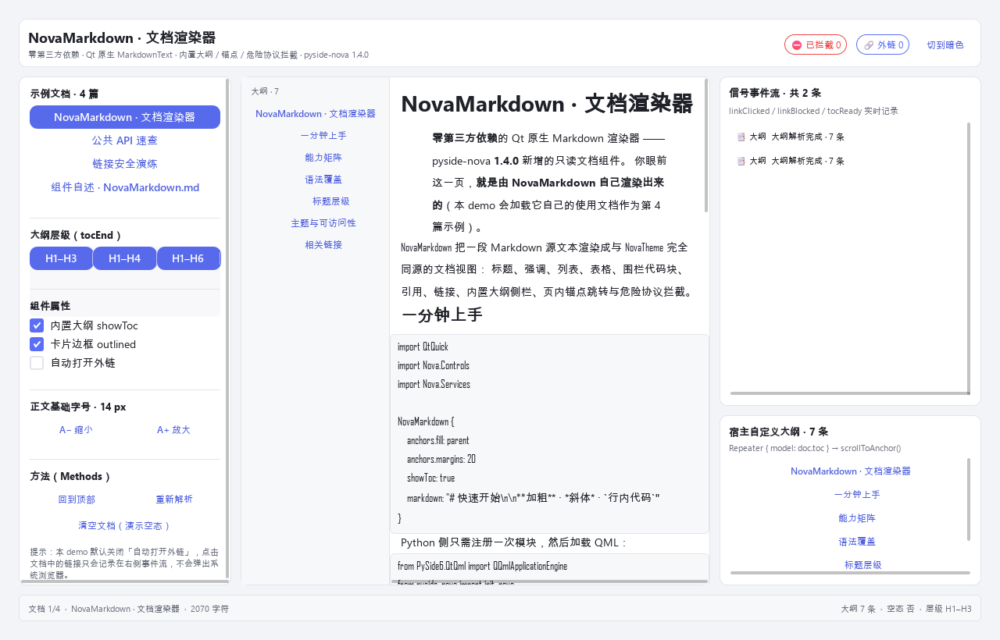
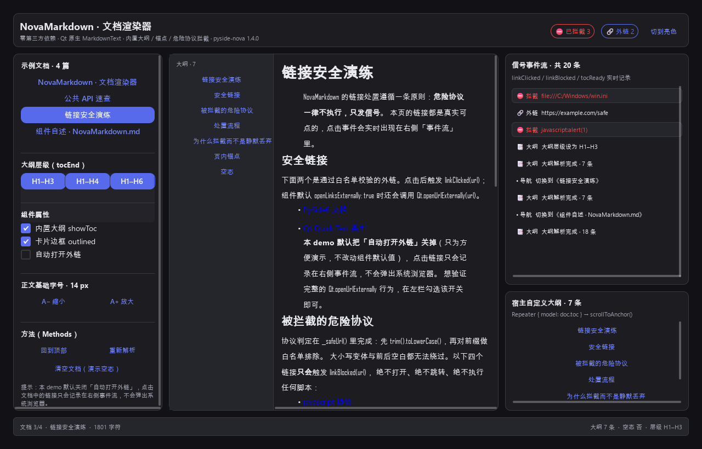

# NovaMarkdown 独立演示

一个可运行的 `NovaMarkdown` 展示工程：加载磁盘上**真实的 `.md` 文件**，用组件渲染，
并把组件的公共 API（8 属性 / 2 只读 / 3 信号 / 3 方法）逐项做成可交互控制台。

> 与 `docs/controls/NovaMarkdown.md`（组件使用文档）账实同源；本 demo 不改动库本体，
> 不新增公共类型，不触发 additive 重签。

## 运行

```bash
# conda pyside6_nova 环境（PySide6 6.8+ 与编辑态 pyside_nova）
python examples/controls/markdown_demo/main.py

# 追加自己的 Markdown 文档（可重复 --doc）
python examples/controls/markdown_demo/main.py --doc ~/notes/CHANGELOG.md

# 只列出将加载的文档，不启动窗口
python examples/controls/markdown_demo/main.py --list

# 离屏真机自检（加载 / 视觉树取证 / 三信号事件链 / 两张截图 / 0 坏 Qt 消息）
QT_QPA_PLATFORM=offscreen QT_QPA_FONTDIR=C:/Windows/Fonts \
    python examples/controls/markdown_demo/verify_offscreen.py
```

> 目录按组件类别归在 `examples/controls/`（与 `examples/layout_shell/` 同级）。
> `main.py` 用 `find_repo_root()` 向上探测含 `src/pyside_nova` 的根，
> 不写死目录层数 —— 再挪一层也不会丢失 dogfooding 文档与图标根。

零第三方依赖：只 `import PySide6` 与 `pyside_nova`，与组件口径一致。

## 效果

| 默认态（亮色） | 交互态（暗色 · 安全演练） |
| :---: | :---: |
|  |  |

> 两张图均由 `verify_offscreen.py` 在真实 `QQmlApplicationEngine` 下离屏渲染截取
> （非静态拼图）。暗色态里 `linkBlocked` 拦截记录、文档切换器选中态、大纲层级
> 三者与文档内容账实同源。

## 文件

| 文件 | 作用 |
|---|---|
| `main.py` | 启动器：读取 `docs/*.md` + 库自身使用文档，注入 QML 上下文 |
| `main.qml` | 三栏主界面（左控制台 / 中文档 / 右事件流 + 外部大纲） |
| `docs/01-overview.md` | 组件总览 + 语法覆盖（标题 / 强调 / 表格 / 列表 / 任务列表 / 围栏 / 引用） |
| `docs/02-api.md` | 公共 API 速查（Props / Signals / Methods 三张表） |
| `docs/03-security.md` | 链接安全演练（4 个危险协议 + 安全外链 + 页内锚点 + 空态） |
| `verify_offscreen.py` | 离屏真机自检脚本（含交互事件链与截图） |
| `markdown_demo.png` / `markdown_demo_dark.png` | 真机离屏截图（默认态 / 暗色交互态） |
| *（运行时注入）* `docs/controls/NovaMarkdown.md` | **dogfooding**：用组件渲染它自己的使用文档 |

示例文档是**真实文件**而非 QML 内硬编码字符串 —— 改 `.md`，demo 立刻跟着变。

> **坑位备忘**：`setContextProperty` 只注入字符串列表，不注入 `list[dict]`。
> PySide6 的 `QVariantList` 在 QML 里 `Array.isArray()` 为 **False**，而
> `NovaBtnToggle` 的 `options` 归一化正是用 `Array.isArray` 判定 ——
> 注入 `list[dict]` 会让切换器归一化为空、`implicitHeight=0` 整块消失。
> 选项数组因此改在 `main.qml` 里用真正的 JS 数组构造。

## 可交互项 → 对应 API

| 界面操作 | 组件 API |
|---|---|
| 顶部文档切换 | `markdown` 属性（源文本替换自动重解析） |
| 大纲层级 H1–H3 / H1–H4 / H1–H6 | `tocEnd` |
| 内置大纲 / 卡片边框 / 自动打开外链 | `showToc` / `outlined` / `openLinksExternally` |
| A− / A+ | `baseFontSize` |
| 明暗切换 | `NovaTheme.toggleDark()`（颜色全部令牌绑定，自动联动） |
| 回到顶部 / 重新解析 / 清空文档 | `scrollToTop()` / `reload()` / `markdown = ""` → `empty` |
| 右侧「宿主自定义大纲」点击 | `toc` 只读属性 + `scrollToAnchor(anchor)` |
| 右侧事件流 | `linkClicked` / `linkBlocked` / `tocReady` 三信号 |
| 底部状态栏 | `toc.length` / `empty` / `tocEnd` / 字符数 |

## 演示要点

1. **`#anchor` 页内跳转**：`docs/02-api.md` 有多个层级标题，点右侧外部大纲条目即可滚动定位。
2. **危险协议拦截**：切到 `03-security.md`，点 4 个红色链接，观察 `linkBlocked` 事件 ——
   `javascript:` / `vbscript:` / `data:` / `file:` 一律不执行。
3. **明暗联动**：切到暗色，正文由 `#1F2128` → `#E9EAEF`，无组件侧重绘逻辑。
4. **空态**：点「清空文档」，组件显示「暂无内容」而不是白屏，`empty` 同步变化。
5. **dogfooding**：第 4 篇文档就是本库 `docs/controls/NovaMarkdown.md`，
   组件渲染自己的使用文档。

> 组件能力边界（语法高亮 / Mermaid / KaTeX / 虚拟滚动）由 Qt 的
> `Text.MarkdownText` 决定，详见 `docs/controls/NovaMarkdown.md` §8，本 demo 不作承诺。
